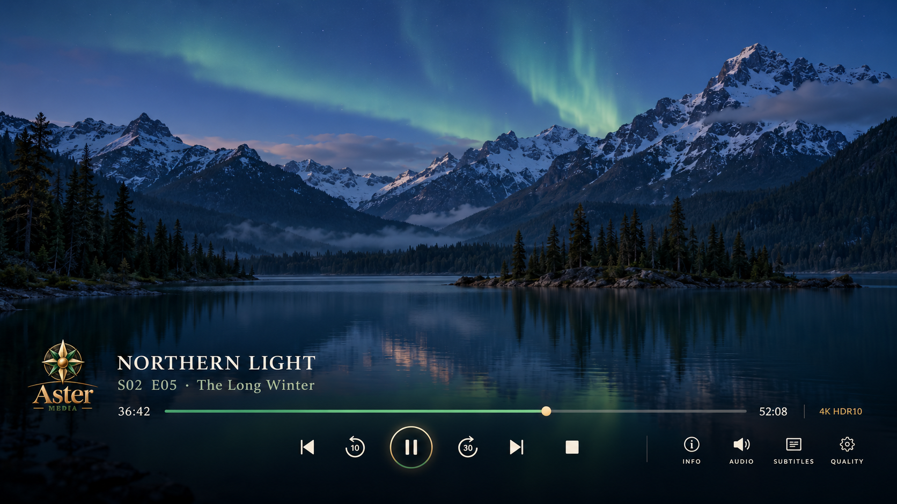

# Aster Home 2.0 — design and feature recommendations

> **Status:** Research-backed programme with its first visual milestone in
> implementation, 2026-10-22. The shared lightweight player language and
> reduced page chrome are deployed as a reversible physical-client candidate;
> the remaining recommendations are not yet implemented. Aster Home 1.0.2
> remains the packaged production candidate until a later release gate.

## 1. Direction

Aster Home 2.0 should keep the calm, warm Aster visual identity and Kodi as the
TV interface, while making each content detail screen behave like a modern
living-room application. The main change is not more decoration. It is a
clearer hierarchy:

1. identity and context;
2. one obvious primary action;
3. a compact set of secondary actions;
4. browsable content with stable directional focus; and
5. deeper information only when requested.

The implementation should borrow interaction patterns, not product artwork,
code, logos, layouts copied pixel-for-pixel, or another product's trade dress.
Approved Aster assets remain the only brand artwork.

## 2. Physical-client findings that shape v2

The HP ProDesk/LibreELEC test confirms that the design can remain visually rich
without becoming sluggish. Live tests passed TV series → season → episode
navigation and playback; album, song and Jellyfin-playlist playback; Daily
Digest story playback and moving highlight; Breaking News; Home status and the
local timer; eBook reader handoff; and all Books catalogue/synopsis views.

The test also found boundaries that v2 must treat as architecture work rather
than skin polish:

- Audiobookshelf catalogue data works, but audio cannot reach the private HTTPS
  reverse proxy at `192.168.50.23` from the client subnet. Do not bypass TLS,
  expose bearer credentials, or substitute token-bearing media URLs. Provide a
  reviewed, least-privilege route before claiming playback.
- Home camera status works, but the preview still references the disposable
  Mac's loopback SSH tunnel. Replace this with a reviewed production camera
  delivery path; do not open Frigate broadly to the media subnet.
- LibreELEC's MP3 player seeks this Digest recording inaccurately by absolute
  time. Aster 1.0.2 now derives a percentage from the verified total duration;
  the selected chapter and on-screen highlight then agree.
- The current sink advertises only 4K30 on the bench path. TV HDR indication,
  AVR passthrough and the selected Bluetooth/USB-HID remote remain physical
  gates, not v2 design assumptions.

## 3. What the reference products teach us

### tvOS and the Apple TV app

Apple's focus guidance is directly applicable to Kodi: every actionable object
must be reachable by directional input; focus should not jump without user
intent; and a focused item should gain elevation/illumination without crowding
its neighbours. The Apple TV app also keeps a show detail context above a
season-specific episode area, with play/resume as the primary action and
episodes, trailers, related content and details below.

**Use in Aster:** stable focus memory, visible but restrained focused-state
scale, hero/details above content, and a season selector immediately adjacent
to an episode list.

### YouTube on TV

YouTube's TV interface makes the left rail expandable, keeps Search reachable
from it, and organizes Home, Subscriptions, History/Watch Later and Playlists
as destinations rather than mixing them into one long page. Voice search is
available from destination pages, and a phone can search or manage the TV
queue.

**Use in Aster:** retain the disappearing Aster rail, add a global search entry
and future microphone affordance, and keep queue destinations explicit. Do not
wrap or imitate YouTube's watch page; launch and visually contain the official
Kodi add-on.

### Playback controls on television

Apple's system player keeps the moving picture dominant and limits custom
transport controls to the actions that matter during playback. Android TV
assigns the centre button to play/pause, left and right to bounded seeking, and
up/down to reveal information without pausing. YouTube places less-frequent
Audio, Subtitles and Quality choices behind a compact settings path rather than
giving each one equal visual weight.

**Use in Aster:** retain every control that Aster 1.0 exposes, but separate
frequency from availability. Use remote buttons for immediate playback and
seeking, one compact unboxed transport rail for visible controls, and a quieter
secondary group for Info, Audio, Subtitles and Quality. The video, title and
progress remain the hierarchy; the controls must not read as a large stone
dialog laid over the programme.

### Plex and Plexamp

Plex uses a useful hierarchy for television: series → seasons → episodes →
episode pre-play. It exposes unwatched episode counts at series level and can
hide season layers for single-season shows. Plexamp prioritizes current art,
queue context, Play Next/Later, related listening, album/artist radio, quality
information, smooth transitions and art-derived backgrounds.

**Use in Aster:** make episode browsing a purpose-built screen, not a generic
poster grid; make the Music player a listening surface with an Up Next lane;
and derive a subdued background colour/blur from art without sacrificing text
contrast.

### Audible

Audible separates the player from a simple chapter/episode list and supports
chapter navigation, adjustable narration speed, chapter-or-title progress,
bookmarks, a queue and sleep timers including end-of-chapter behaviour.

**Use in Aster:** preserve Aster's stripped-back two-column audio player, then
add only high-value listening controls that Audiobookshelf/Kodi can support
honestly: chapter jump, speed, sleep timer, progress and eventually bookmarks.

### Home Assistant

Home Assistant's current Sections view uses a responsive grid, grouped cards,
small at-a-glance badges, per-card features and conditional visibility. It
retains spatial memory by keeping related cards together as widths change.

**Use in Aster:** organize the Home page into named sections with fixed TV
positions, use badges only for exceptional state, and hide unavailable or
irrelevant cards instead of displaying empty shells.

## 4. Recommended 2.0 work, in priority order

### P0 — close v1 production dependencies first

1. Authorize and implement a narrow client-to-Audiobookshelf HTTPS path, then
   test audiobook chapters and podcast episodes for start, seek, pause, resume,
   stop and progress persistence.
2. Replace the Mac camera tunnel with a least-privilege production preview
   path, bounded by camera identity, short lifetime and read-only access.
3. Complete remote pairing/reconnect, TV HDR10 indication, AVR codec/
   passthrough and full-profile recovery tests.
4. Automate safe, atomic Books and Home feed publication with freshness and
   last-success visibility. Never make stale household state look current.
5. Return to official YouTube setup only after the core appliance gates pass.

These are 1.0.x completion items, not reasons to mix unfinished infrastructure
into the v2 visual branch.

### P1 — television series and episode detail

This is the highest-value v2 interface change.

- Keep a full-width, dimmed/graded series hero with title, synopsis, rating,
  year, genre and unwatched count.
- Make **Resume next episode** the primary green button. Use **Play from
  beginning**, **More info** and **Mark watched/unwatched** as secondary actions.
- Put compact season pills or a season chooser directly above episodes. Hide
  the chooser for single-season series; keep Specials explicit.
- Use a vertical episode list on TV: 16:9 still at left; `S02 E05`, title,
  two-line synopsis, duration and air date at right. Show three to five complete
  rows at once and a partial next row as a scroll cue.
- Keep progress bars, watched checks and unwatched dots in fixed positions.
  Focus should illuminate the whole row and expand by only a few percent.
- Restore focus to the prior episode after returning from playback or details.
- Place cast, extras, related titles and other seasons below the episode list,
  not between the primary action and the episodes.
- Treat alternate episode ordering and multi-episode files as metadata facts;
  never invent numbering in the skin.

### P1 — global shell and navigation

- Preserve the compact/expanded left rail but remember the last destination
  and focused item in each page.
- Add a global search overlay that can return Movies, Shows, Episodes, Music,
  Books and Podcasts in grouped results. Keep YouTube search within YouTube.
- Add a top-level **Continue** destination that unifies resumable video, audio
  and reading handoffs while clearly labelling the source and media type.
- Standardize Back: first close an overlay, then return to the parent content
  level, then expose the rail. Never strand focus in decorative controls.
- Standardize empty, loading, stale, offline and permission-denied states.

### P1 — compact video-player controls

**Milestone status, 2026-10-22:** the first implementation pass now replaces
the boxed video OSD with a lower-edge gradient, compact unboxed controls and a
thin sage/gold focus ring. The same reusable control treatment is applied to
Music, Books audio/Podcasts and Daily Digest without changing their Kodi
actions or data authority. This is deployed from source to the physical client
with a rollback checkpoint; it is not yet a new packaged release.

- Remove the current 1800 × 370 stone panel and every persistent per-control
  box. Use only a restrained lower-edge black gradient for contrast over the
  moving picture.
- Preserve the current ten functions: Previous, −10 seconds, Play/Pause,
  +30 seconds, Next, Stop, Info, Audio, Subtitles and Quality. This is a visual
  simplification, not a capability reduction.
- Keep title and episode context at lower left, elapsed/total time at the ends
  of one thin progress line, and active resolution/HDR state as quiet factual
  metadata. Never claim HDR or 4K from filename metadata alone.
- Centre a compact icon-only transport rail. Play/Pause is slightly larger;
  all other transport icons share one smaller size. Unfocused controls have no
  background. The focused control receives a thin sage/gold halo, modest scale
  and elevation, with no clipped glow.
- Keep Info, Audio, Subtitles and Quality in a smaller secondary group on the
  same baseline. Labels may remain beneath their icons for ten-foot clarity,
  but the group must not compete visually with transport controls.
- Make the remote itself the fastest control path: centre toggles play/pause,
  left/right seek by the configured intervals, and up/down reveal the OSD
  without changing playback. OSD focus should initially land on Play/Pause.
- Keep Kodi as playback authority. Audio and Subtitle open Kodi's real stream
  selectors; Quality continues to show the active stream or Kodi processing
  settings when no alternate resolution exists; Info returns to the current
  full-screen information view.
- Auto-hide after inactivity, restore the programme without a residual panel,
  and retain a reduced-motion option. Opening a selector pauses the hide timer
  and Back first closes the selector, then the OSD.

The mockup below is a hierarchy and spacing target, not copied product trade
dress. The fictional programme still and generated layout are disposable;
production implementation must use the exact approved Aster logo and icon
assets already in the private brand package.

### P1 — Music, audiobooks and podcasts

**Music**

- Add an Up Next queue to the right of the stripped-back player.
- Support Play Next, Play Later, remove from queue, save queue as playlist and
  clear queue with confirmation.
- Add album/artist radio or “more like this” only when backed by real Jellyfin
  data; do not present random results as recommendations.
- Expose codec, bit depth/sample rate and output path in a quiet details layer,
  not in the primary controls.
- Use art-derived UltraBlur-style colour fields as inspiration, rendered with
  Aster's stone/green palette and contrast rules.

**Audiobooks**

- Keep cover/player left and unboxed chapter list right.
- Add current chapter, book progress, ±30 seconds, narration speed and sleep
  timer presets including end of chapter.
- Add bookmarks only after Audiobookshelf progress/bookmark authority and
  multi-client conflict behaviour are tested.

**Podcasts**

- Give each show a detail page with square art, synopsis and a newest/oldest
  order toggle.
- List episodes vertically with publish date, duration, two-line summary,
  played/progress state and download/availability state.
- Add Play Next/Later and a persistent episode queue; never auto-download or
  subscribe without an explicit user action.

### P2 — Aster Reader and synchronized narration

- Replace the television's URL-only eBook handoff with an Aster Reader for
  DRM-free, reflowable EPUB titles while retaining Calibre as catalogue and
  source authority. Do not modify source books or attempt to remove DRM.
- Use a dedicated reader service to sanitize and paginate EPUB XHTML, render
  each television page faithfully, and publish a bounded page manifest with
  stable text locations and word bounding boxes. Kodi should display the page
  and move one lightweight highlight overlay rather than trying to reproduce
  arbitrary EPUB HTML in skin labels.
- Narrate exact book text through Aster's canonical local Kokoro `bm_daniel`
  voice at the approved language, speed, cleanup and sentence/clause cadence.
  Do not create another application-local voice implementation.
- Extend the canonical batch speech contract to return validated phoneme/word
  timing, or align completed local audio against the exact source text when
  the approved model cannot expose duration data. Never estimate timing from
  character or word length.
- Buffer the opening sentences, then synthesize the remainder of the chapter
  through the lower-priority batch queue. Cache private derived chapter audio
  and timing manifests independently of the original book; make cache removal
  explicit and never distribute generated narration.
- Provide a calm reading page with adjustable type size, margins and line
  spacing; word, phrase or sentence highlighting; automatic page turns;
  Play/Pause; sentence/paragraph seeking; chapter navigation; narration speed;
  sleep timer; and a Follow narration toggle.
- Store resume state as a stable EPUB location plus text offset so reading and
  narration return to the same passage. Cross-device synchronization remains
  a later authority decision rather than a second uncoordinated progress store.
- Start with one real EPUB and one chapter. Gate expansion on timing drift,
  page-turn accuracy, pronunciation, first-audio latency, long-run queue
  behaviour and remote-only usability. PDF/OCR, fixed-layout books and complex
  interactive content are explicitly later work.

### P2 — Digest and Breaking News

- Keep the active story image and summary tied to audio position.
- Add a compact progress timeline with story boundary marks and Next/Previous
  story actions.
- Add **Read story** and **Sources** where the published feed provides safe
  links; distinguish generated summary from source reporting.
- Allow a briefing queue (morning, evening, saved stories) only after the news
  service publishes stable identities and durations.
- Preserve the fast Breaking News page as a separate glanceable destination;
  avoid turning the Daily Digest into an infinite news feed.

### P2 — Home dashboard

- Use a responsive four-column Sections-style grid on the 1080p design canvas.
  Camera and timer may span two columns; simple sensors use one.
- Add a restrained header badge row for security, indoor comfort, air quality,
  connectivity and active timers. Show exceptions before normal status.
- Group by intent—**Now**, **Rooms**, **Security**, **Climate**, **Routines**—
  rather than listing raw Home Assistant entities.
- Make controls visually different from read-only state. Require confirmation
  for security-sensitive actions and keep unavailable controls non-focusable.
- Preserve the current Aster timer ring, but source named Home Assistant timers
  when the integration is authorized; retain the local timer as an explicit
  fallback rather than silently conflating them.
- Camera cards should show freshness, privacy state and failure reason. Never
  leave a stale frame looking live.

### P2 — appliance startup branding

- Extend the accepted Aster startup sequence one stage earlier by replacing
  the HP firmware/POST image with an approved Aster-on-black logo. If visual
  silence proves preferable in the room, test a plain black image as the
  fallback; do not alter or redraw the approved Aster artwork.
- Treat this as firmware state, not a Kodi skin asset. The physical endpoint
  reports an HP ProDesk 400 G5 Desktop Mini with R23 BIOS 02.20.00 dated
  2023-12-15. HP's commercial BIOS utility supports a custom JPEG no larger
  than 32,768 bytes through `HpFirmwareUpdRec.exe -e<filename>` and removes it
  with `-x`; the operation is command-line only and requires a BIOS password
  file when an administrator password is configured.
- Prepare and validate an HP BIOS-recovery USB before changing the logo. Run
  the official utility from a temporary Windows or WinPE environment, never
  from LibreELEC and never through an unofficial firmware editor. Capture the
  current BIOS identity, utility log and clean-boot evidence before and after.
- Keep firmware maintenance separate from artwork installation. HP currently
  lists R23 02.22.00 for this exact model with later security fixes, but a BIOS
  upgrade is not required merely to test custom-logo support. Evaluate and
  authorize any firmware upgrade as its own recoverable maintenance change.
- Fail closed if the utility reports unsupported firmware, an invalid image or
  a security violation. Do not bypass firmware signing, Secure Boot, BIOS
  passwords or HP recovery protections to obtain a branded screen.
- Preserve the already deployed `/flash/oemsplash.png` LibreELEC image and
  `/storage/.kodi/media/splash.png` Kodi image independently. The desired
  sequence is firmware Aster mark → LibreELEC Aster splash → Kodi Aster splash;
  failure or rollback at one layer must not remove branding at the others.

### P2 — polish, accessibility and performance

- Define one focus contract for tiles, rows, pills, buttons and text fields.
  No clipped halos, exposed square image corners or title movement on focus.
- Offer reduced-motion and high-contrast variants. Test 10-foot readability at
  1080p and scaled 4K, including long titles and two-line synopses.
- Keep visible rows bounded and lazy-load artwork. Pre-cache only the selected
  hero and the next screenful; release artwork when a page closes.
- Keep periodic work bounded through Kodi alarms/short scripts. No permanent
  Python worker should be added merely to animate or poll a screen.
- Add automated focus-graph tests for every page and live smoke tests for every
  playable media type before a release candidate is installed.

## 5. Proposed delivery sequence

1. **2.0 design prototype:** compact video OSD, series/season/episode page and
   global focus contract using existing Kodi/Jellyfin data; no new service.
2. **2.0 alpha:** global shell, search overlay and media detail hierarchy.
3. **2.0 beta:** Music queue, audiobook/podcast refinements and Digest controls,
   after their production network paths pass.
4. **Aster Reader proof:** one DRM-free EPUB chapter, canonical Aster narration,
   measured timing and synchronized highlighting; keep this service-dependent
   work independently reversible from the television UI branch.
5. **2.0 release candidate:** Home sections, accessibility, performance soak,
   remote-only navigation audit and recovery rehearsal.
6. **Optional appliance-branding gate:** with the release candidate otherwise
   stable, create the compliant firmware JPEG, prepare HP recovery media, test
   custom-logo install/removal from temporary WinPE, and retain evidence of a
   clean cold boot. This gate must not block the software release if the R23
   firmware reports custom-logo support as unavailable.

Each stage should be a separate resumable milestone with a local commit,
physical endpoint evidence and an immutable release package. Promotion should
not overwrite the last accepted v1 artifact or its rollback checkpoint.

## 6. Acceptance criteria

- Every visible action is reachable and reversible using only the selected
  remote; focus always remains visible.
- A user can reach the next unwatched episode from Home in three selections or
  fewer and can browse another season without losing their place.
- Every player exposes the controls appropriate to its media type and returns
  to the previously focused item.
- The video OSD exposes all ten accepted v1 functions without persistent
  button boxes; remote centre/left/right/up/down behaviour remains predictable,
  and focus is visible without obscuring programme content.
- The Reader proof highlights the correct spoken passage without cumulative
  drift, turns pages at the right boundary and resumes the same EPUB location
  after restart; no book text or generated narration leaves the HomeLab.
- Empty, stale, offline and forbidden states are truthful and visually calm.
- No credential, token URL, private source path or household entity ID appears
  in skin XML, logs, screenshots or release archives.
- 1080p canvas scaling, 4K output, memory, temperature and artwork loading meet
  or improve the v1 physical baseline.
- The complete v1 skin and profile rollback remain independently usable.
- Firmware branding either displays the approved Aster image through a clean
  cold boot or remains untouched; its rollback restores HP's normal POST image
  without affecting the LibreELEC or Kodi splashes.

## 7. Research sources

- Apple, [Focus and selection](https://developer.apple.com/design/human-interface-guidelines/focus-and-selection/)
- Apple, [Interface fundamentals](https://developer.apple.com/documentation/technologyoverviews/interface-fundamentals)
- Apple, [Find things to watch](https://support.apple.com/guide/tvapp/find-things-to-watch-atvbb35c9fc3/web)
- Apple, [Customizing the tvOS playback experience](https://developer.apple.com/documentation/avkit/customizing-the-tvos-playback-experience)
- Apple, [Playing video](https://developer.apple.com/design/human-interface-guidelines/playing-video)
- Apple, [Remotes](https://developer.apple.com/design/human-interface-guidelines/remotes)
- Google, [Explore the YouTube app on your TV](https://support.google.com/youtube/answer/7583931?hl=en-GB)
- Google, [Latest improvements to YouTube on TV](https://support.google.com/youtube/thread/308597587/q4-24-quarterly-update-latest-improvements-to-youtube-on-tv?hl=en)
- Google, [Playback controls on TV](https://developer.android.com/training/tv/playback/controls)
- Google, [Change video quality](https://support.google.com/youtube/answer/91449)
- Plex, [Using the Library View](https://support.plex.tv/articles/200392126-using-the-library-view/)
- Plex, [Modern Layout](https://www.plex.tv/blog/choose-your-own-adventure-introducing-modern-layout/)
- Plex, [Plexamp](https://plexamp.com/)
- Audible, [Browse chapters and episodes](https://help.audible.com/s/article/browse-chapters-and-episodes?language=en_US)
- Audible, [View player settings](https://help.audible.com/s/article/view-player-settings)
- Audible, [Manage clips and notes](https://help.audible.com/s/article/manage-clips-bookmarks?language=en_CA)
- Home Assistant, [Sections](https://www.home-assistant.io/dashboards/sections/)
- Home Assistant, [Dashboard cards](https://www.home-assistant.io/dashboards/cards/)
- Home Assistant, [Badges](https://www.home-assistant.io/dashboards/badges)
- W3C, [EPUB Media Overlays 3.2](https://www.w3.org/publishing/epub32/epub-mediaoverlays.html)
- W3C, [EPUB Reading Systems 3.3](https://www.w3.org/TR/epub-rs-33/)
- Readium, [Navigator architecture](https://readium.org/technical/r2-navigator-architecture/)
- Readium, [Guided Navigation](https://readium.org/guided-navigation/)
- Kodi, [Python Window API](https://xbmc.github.io/docs.kodi.tv/master/kodi-dev-kit/group__python__xbmcgui__window.html)
- Kokoro ONNX, [duration-enabled model releases](https://github.com/thewh1teagle/kokoro-onnx/releases)
- HP, [Commercial BIOS (UEFI) Setup Administration Guide](https://ftp.hp.com/pub/caps-softpaq/cmit/whitepapers/HPBIOSSetup.pdf)
- HP, [R23 BIOS 02.22.00 for the ProDesk 400 G5 Desktop Mini](https://ftp.hp.com/pub/softpaq/sp156501-157000/sp156688.html)

