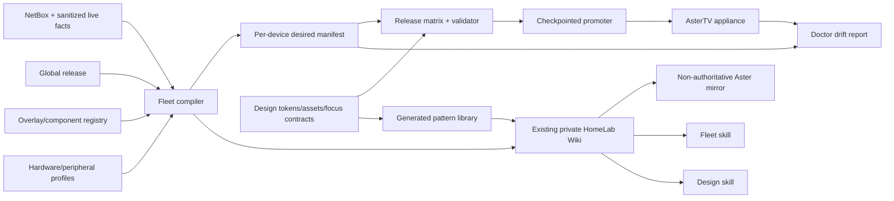

# AsterTV Platform Engineering and Design Operations

> Status: Active — Stream A; M0–M2 complete locally, M3–M6 foundations built
>
> Owner: Jason
>
> Proposed: 2026-11-05
>
> Authorization: Stream A — approved by Jason on 2026-11-05

## Purpose and desired outcome

Create the durable operating system for two functions:

1. **Fleet Engineering and Operations** — build, onboard, configure, secure,
   deploy, maintain, repair and retire AsterTV appliances whose computer
   hardware, displays, receivers, soundbars and network paths differ.
2. **Experience Design** — own the definitive visual language, source assets,
   components, pages, focus behavior, mockups and Kodi implementation guidance.

An engineer or future agent must be able to begin at one private wiki page,
identify the authority for every fact, calculate the exact desired composition
of an appliance, make a bounded repair or release, validate the whole fleet and
leave enough evidence for someone else to continue. Designers must find the
approved asset, token, component state, page example and navigation behavior
without reverse-engineering a live box or searching old conversations.

The project extends the existing private Forgejo-backed `homelab-wiki`, its
MkDocs navigation, LXC 113 intake/collector, `homelab-reference`, NetBox,
HomeLab Doctor and the non-authoritative Aster mirror. It creates no competing
wiki. It produces no new speech; future speaking surfaces inherit the canonical
Aster British-English voice contract.

## Department operating model

### Fleet Engineering and Operations

- fleet inventory, composition, lifecycle, releases and recovery;
- hardware and peripheral qualification: HDMI/eARC/CEC, EDID, HDR, Dolby,
  stereo, remotes, microphones, Wi-Fi and standby;
- LibreELEC, Kodi, add-ons, skins, Python and systemd;
- Jellyfin playback and client/server compatibility;
- Seerr and ARR dependencies across Sonarr, Radarr, Lidarr, Prowlarr, Bazarr,
  SABnzbd and current/archive libraries;
- Home Assistant room entities and capability-scoped equipment bridges;
- DHCP, DNS, VLAN, firewall and credential boundaries; and
- backup, Doctor, monitoring, incidents, training and handover.

### Experience Design

- AsterTV tokens, approved assets and usage contexts;
- component states, page templates and reference implementations;
- remote-first focus graphs, OK/Back/Menu, scroll and return-focus behavior;
- text fitting, artwork ratios, masks, fades and low-spec behavior;
- accessibility, readability, contrast and reduced motion; and
- synthetic fixtures, renders and visual acceptance evidence.

### Role boundaries

| Role | Owns | Does not silently own |
|---|---|---|
| Product owner | Outcome, priority and visual acceptance | Technical details or secrets |
| Fleet engineer | Composition, build, deployment and recovery | Unapproved visual exceptions |
| Design engineer | Tokens, assets, components and navigation | Production mutation or capability claims |
| Service owner | Jellyfin/ARR/HA/network facts | AsterTV presentation |
| Release reviewer | Diff, regression and promotion evidence | An unexplained exception they authored |
| Operator | Supported operation and documented recovery | Ad-hoc live edits |

One person or agent may hold several roles, but the evidence must name the role
and authority used for each decision.

## Current state and evidence

- AsterTV v2 has an immutable final release and target-aware promoter. Family
  retains HDMI Dolby/HDR; Bedroom retains stereo.
- A host-bound pre-Kodi guard restores an accepted snapshot for seven Kodi
  roots. It deliberately ignores extra files and cannot classify approved,
  stale and experimental overlays.
- V3 has deterministic but separately managed Jen, Family and Bedroom overlays
  plus external HA, firewall, audio, Wi-Fi, identity and Remote components.
- Active devices are Family, Bedroom and low-spec Jen; Guest is expected. Jen's
  1080p/stereo constraints are client-specific, not a global ceiling.
- `homelab-wiki` is healthy in Forgejo at
  `c9bd0114f3157cd128cd5ee2dda1c3f697fb90cb`; it uses MkDocs and the Human Wiki
  Contract, but has no AsterTV department today.
- LXC 113 already supplies bounded intake, provenance, quarantine,
  content-addressed originals, daily collection, monthly health and mirror
  generation.
- NetBox owns adopted hardware/network facts; `homelab-reference` owns reviewed
  current operations; the Aster mirror is derived and non-authoritative.
- Approved private Aster brand releases include masters, exports, checksums,
  manifests and contact sheets. Runtime design assets remain scattered among
  v2/v3 payloads and release archives.
- The general navy/cyan HomeLab UI guide is for internal web applications, not
  the television surface. AsterTV needs a dedicated standard for its accepted
  brown/cream, charcoal, jade and champagne-gold language.
- The portfolio previously linked to a missing
  `docs/Environment-and-Release-Lifecycle.md`. M1 restored and adopted that
  lifecycle authority rather than relying on a broken prerequisite.

## Problem statement

No single machine-readable authority answers:

> Which global release, hardware profile, room/peripheral profile, approved
> overlays, external services and credential references constitute this exact
> AsterTV?

Consequently, a global upgrade can overwrite a local repair, a hash-bound
overlay can fail after a legitimate base change, an obsolete overlay can
survive, and evidence can be mistaken for current desired state. Accepted
design decisions are similarly distributed across pages and conversations.

## Scope

### In scope

- schema-versioned fleet contract and component/overlay registry;
- complete desired-state manifest for every appliance;
- hardware, peripheral, room, capability and network profiles;
- deterministic composition, diff, validation, deployment and rollback tools;
- release matrix and lab-first promotion;
- an AsterTV department in the existing HomeLab Wiki;
- version-matched curricula for Kodi, LibreELEC, Jellyfin, Home Assistant and
  the relevant ARR stack;
- appliance/peripheral onboarding, replacement and retirement;
- HA, firewall, DNS/DHCP, VLAN, credentials, backup and incident procedures;
- asset provenance, tokens, components, pages, focus graphs and pattern library;
- synthetic mockups for every resource/component/action family below;
- `astertv-fleet-engineer` and `astertv-design-engineer` Codex skills;
- Doctor, monitoring, backup, NetBox, wiki/mirror and release integration; and
- migration of approved local differences without changing accepted behavior.

### Exclusions

- media-file, watch-state, ARR-queue or acquisition-policy mutation;
- making live state match an unapproved draft;
- public wiki/Forgejo/admin ingress or secrets in Git/wiki;
- replacing NetBox, `homelab-reference` or the Human Wiki Contract;
- a new visual language without owner acceptance;
- treating Jen limitations as fleet limits;
- automatic production promotion without gates and idle checks; and
- upgrading products merely because a newer version exists.

## Authority model

| Fact | Authority | Presentation/consumer |
|---|---|---|
| Device, interface, MAC, IP, VLAN, cable, placement | NetBox | Wiki equipment page; compiler/Doctor |
| Current state/version | Sanitized live query | Operational reference and fleet status |
| Desired AsterTV composition | Git fleet contract | Wiki, compiler, guard and skills |
| Global release bytes | Forgejo release + checksums | Release catalogue and promoter |
| Device exception | Overlay registry + decision record | Device page and compatibility gate |
| Secret value | Existing custodian/source-local file | Identifier/rotation procedure only |
| HA entity/capability | HA live registry + reviewed mapping | Room page and bridge contract |
| Firewall/DNS/DHCP | OPNsense live config + reviewed reference | Runbook, drift and onboarding |
| Design behavior | Git AsterTV design system | Wiki pattern library and tests |
| Source asset | Private Forgejo asset release | Asset catalogue/export pipeline |
| Upstream docs | Version-pinned wiki source | Curricula and derived Aster mirror |
| Decision/evidence | `homelab` project record | Wiki links and future agents |

Conflicts name both sources and dates; no tool or skill silently promotes a
lower-authority source.

## Architecture



### Placement

- `homelab`: schemas, compiler, registry, build/deploy/test tools, design source,
  skills, project and evidence.
- `homelab-wiki`: employee curricula, fleet/device/peripheral pages, pattern
  library, onboarding, operations and incident guides.
- `homelab-reference`: reviewed current procedures and facts.
- `aster-knowledge-mirror`: reproducible summaries, never authority.
- private Forgejo releases: immutable base/asset/per-device bundles.
- LXC 113: existing wiki/intake/collector/static site.
- appliances: accepted manifest, last-known-good payload, local status,
  source-local credentials and checkpoints.

## Fleet composition contract

Required objects:

1. `fleet.yaml`: member, lifecycle, room, hardware/peripheral profile, channel.
2. `releases/<version>.yaml`: immutable artifact, hashes and compatibility.
3. `hardware/<profile>.yaml`: measured compute/storage/network/display envelope.
4. `peripherals/<profile>.yaml`: display/receiver/soundbar, ports, EDID,
   CEC/eARC, HDR/audio, controls and recovery.
5. `overlays/<component>.yaml`: owner, selectors, dependencies, compatibility,
   owned files/services/settings, secret refs, installer, rollback and tests.
6. `devices/<hostname>.yaml`: approved irreducible local deviations only.
7. `desired/<hostname>.json`: resolved components, order, hashes and dependencies.
8. `observed/<hostname>.json`: sanitized Doctor output, never desired state.

Rules:

- global behavior belongs in the release; reusable differences in profiles;
- one-box exceptions require owner, reason, review/expiry and test;
- each path/service/setting has one owner per layer;
- conflicts and incompatible dependencies fail compilation;
- secret values never enter manifests;
- identical inputs produce identical manifests and bundles;
- global promotion requires every active composition to compile and test;
- promoter shows the diff, refuses playback, checkpoints, installs atomically
  and rolls back on health/hash failure; and
- the guard restores the compiled accepted composition and identifies unknown
  registered-component files while excluding mutable state and credentials.

## Fleet lifecycle and onboarding

Lifecycle states are `candidate`, `lab`, `accepted`, `production`, `degraded`,
`retiring` and `retired`; environment promotion and version are separate.

### New appliance

1. Register hardware, interfaces, MAC/IP/VLAN, room, power and cabling in NetBox.
2. Measure capability; never infer 4K/HDR/audio from marketing alone.
3. Install approved LibreELEC/Kodi baseline and source-local identities.
4. Capture peripheral chain, EDID, audio, CEC/eARC, standby and physical recovery.
5. Compile/review inherited and local components.
6. Add only exact network/HA paths required.
7. Test synthetic navigation/playback, then bounded real codec/audio/HDR/resume/
   subtitle cases.
8. Prove restart, reboot, dependency loss, rollback and physical recovery;
   enroll Doctor, monitoring and backup.
9. Publish equipment page, handover, desired manifest and acceptance evidence.

### Peripheral addition/replacement

Preserve the old chain; identify model/firmware; capture EDID/audio/control;
establish HA state feedback and semantic actions; update only exact network
paths; test CEC fan-out, duplicate commands, volume/mute, HDR/audio and physical
recovery; then create/reuse a profile and compile every affected device.

### Release, incident and maintenance

- development, lab candidate, accepted and production channels;
- Kodi/LibreELEC/Python/Jellyfin/add-on compatibility and deprecation policy;
- SBOM, license and security-advisory review;
- lab-first rollout, Bedroom before Family, stop conditions and rollback;
- restore service before speculative redesign during incidents;
- classify defects by owning layer and add a regression fixture;
- never turn an emergency live edit into desired state without a component;
- monthly documentation/source health, quarterly fleet/EOL review; and
- post-deployment intent, efficiency and operator-friction review.

## Required curricula

Every curriculum provides architecture, local topology/version, pinned sources,
customizations, operation, diagnostic tree, safe/prohibited changes,
backup/restore, upgrade compatibility, incidents and competency labs.

- Kodi: windows, controls, focus, keymaps, JSON-RPC boundary, add-ons, skin XML,
  properties, cache and logs.
- LibreELEC: immutable OS, `/storage`, systemd, audio/GPU/input/network,
  update/rollback and appliance recovery.
- Jellyfin: libraries, users, playback/direct play/transcode, API identity,
  metadata, Intro Skipper, watch state and recovery.
- ARR: Sonarr/Radarr/Lidarr/Prowlarr/Bazarr/SABnzbd/Seerr boundaries, profiles,
  indexers, downloads/imports, permissions and current/archive libraries.
- Books/listening: Calibre, narration compiler and Audiobookshelf.
- YouTube: official add-on, API quota, identity, guest limits and recovery.
- Home Assistant: entities/devices/config entries, native integrations, backup,
  config check/restart, recorder evidence, unavailable state and semantic calls.
- OPNsense/network: VLANs, aliases, rule order, state, DHCP, DNS, mDNS/SSDP,
  config backup/reload/denial testing and rollback.
- Aster services: Remote, AI broker, News, speech, wiki and capability identities.
- Storage/observability: TrueNAS, checkpoints, restore order, Doctor, Beszel,
  NetBox, logs and authority conflicts.

## Existing wiki information architecture

Extend `homelab-wiki` MkDocs:

```text
AsterTV
  Start here
  Fleet status and release matrix
  Devices: Family / Bedroom / Jen / Guest
  Hardware profiles
  Peripheral and room chains
  Build, composition and release
  Onboarding and retirement
  Operations
    Kodi and LibreELEC
    Jellyfin and playback
    ARR and requests
    Home Assistant
    Network and firewall
    Identity and credentials
    Backup and recovery
    Monitoring and Doctor
  Incidents and known problems
  Training and competency labs
  Design system
    Foundations and tokens
    Asset catalogue
    Components and states
    Page templates
    Navigation and focus
    Pattern library
    Accessibility and content
```

Pages declare owner, authority, versions/devices, review date, sources and
recovery. Imported documentation continues through existing intake,
provenance, licensing, secret and quarantine controls. Current procedures link
to `homelab-reference` rather than duplicating drift-prone facts.

## AsterTV design authority

### Foundations

- ink `#171C19`, charcoal `#242B25`, warm white `#F5F1E8`, soft text `#BFC6BB`,
  champagne gold `#D8B778`, jade `#235640`, light jade `#A7C5AA`;
- brown/charcoal-to-cream diagonal page blend and artwork fades without a hard
  split;
- tested television typography and bounded labels;
- restrained motion and reduced-motion equivalents;
- limestone-backed compass icons only on the floating side rail/launcher;
- plain compass icons on top rails and pills; and
- verified Forgejo masters/exports, never screenshot-derived assets.

### Component language

- artwork at rest has no selection box;
- focused artwork uses narrow jade top/sides and a deeper title treatment;
- current-but-unfocused uses gold only where persistent context is required;
- pills keep identical rest/focus dimensions and contour; focus sharpens the
  gold rim and introduces jade without shifting layout;
- disabled actions are not focusable and explain actionable failure;
- Play, Resume and Trailer use distinct semantic icons;
- the side rail is vertically centred, partially off-screen and limestone-only;
- the top rail follows Media geometry with separate gold-rim Search and 24-hour
  clock where specified; and
- heroes preserve a text-safe area, blend into the page and contain no action
  without defined behavior.

### Exhaustive mockup catalogue

Every row gets a synthetic fixture, 1920×1080 rest/focus render, focus graph and
implementation notes; web Remote surfaces also get phone-width renders.

| Resource/action family | Required states |
|---|---|
| Logos, plain compass, stone icons | source/context, light/dark/small, forbidden-use example |
| Backgrounds and hero fades | media/music/books/news/AI, image/no-image, text-safe area |
| Top and side rails | rest/focus/current, expanded/collapsed, first/last, return focus |
| Search/filter/clock/category pills | rest/focus/current/disabled, long text, missing data |
| Artwork tiles | poster/square/cast/landscape, rest/focus/current/watched/unwatched/error |
| Buttons | rest/focus/pressed/disabled/busy/confirm/destructive/recovery |
| Player controls | Play/Resume/Trailer/pause/stop/queue/skip/unavailable |
| Dialogs | resume/skip/working/error/offline/confirmation/AI command/search |
| Lists and rails | cast/related/seasons/episodes/tracks/articles/search/long-scroll |
| Pages | Media/TV/Movie/Music/Books/News/YouTube/Requests/Home/Cameras/Search/Settings |
| Ambient | screensaver/startup/wake/restore/no-content |
| Remote PWA | room/touch/voice/keyboard/equipment, portrait/landscape |
| Remote actions | OK/Back/Home/Menu/directions/long-press/scroll/wrap/return-focus |

Fixtures cover long titles, missing/low-resolution art, more than eight seasons,
long lists, unavailable dependencies and watched states. They exclude private
camera/account data and secrets.

Every page has a machine-readable focus graph naming controls, directional
neighbors, activation, Back, entry/return focus, scrolling and dynamic rules.
Orphans, ambiguous edges, hidden targets and artwork-covered controls fail the
build. Visual and actual Kodi focus must agree.

## Codex skills

Track under `services/codex-skills/`, validate with the Codex validator and
install deterministically into the user skill directory with a source manifest.
Automatic discovery remains enabled; skills never grant mutation authority.

### `astertv-fleet-engineer`

For build, onboarding, audit, repair, deployment, peripherals, playback, HA and
network work. It locates the fleet contract, resolves authority, compiles and
diffs desired state, repairs the owning layer, enforces idle/checkpoint/network/
secret boundaries, runs fleet regressions and fails closed on identity,
composition or rollback uncertainty.

### `astertv-design-engineer`

For page, component, asset, interaction, navigation, mockup and Kodi-skin work.
It loads the relevant tokens/assets/contracts, enforces icon contexts, renders
realistic states first, updates the focus graph, maps designs to Kodi XML/tests,
checks hardware classes, requires owner acceptance for new patterns and hands
deployment to the Fleet Engineer workflow.

Both receive independent forward-testing with realistic raw inputs and no
intended answer supplied to the evaluator.

## Logic-review additions

The project also requires:

1. configuration ownership and exception expiry;
2. compatibility/deprecation policy;
3. SBOM, licenses and supply-chain record;
4. security patch/vulnerability response;
5. boot, latency, memory/CPU/GPU/network/cache budgets by hardware class;
6. accessibility/content standards;
7. synthetic-test and screenshot privacy policy;
8. incident, problem and change records;
9. spares, warranty, EOL and secure retirement;
10. operator/designer/reviewer competency matrix;
11. architecture decision records;
12. service objectives and documentation freshness;
13. user/household support and Guest boundaries; and
14. authority-link checking, including the missing lifecycle document.

## Privacy and security

- private Forgejo/wiki/split-DNS/Auth patterns remain; no public route;
- Git/wiki contain secret identifiers and procedures, never values;
- skills have no standing credentials and do not widen authorization;
- network changes remain exact source/destination/protocol/port;
- observed manifests exclude titles, watch history, account content, camera
  frames and credentials;
- design fixtures are synthetic; and
- imported documentation uses existing provenance/licensing/quarantine controls.

## Pre-start risk assessment

| Risk | Likelihood / impact | Control |
|---|---|---|
| Draft becomes authority | Medium / High | Candidate/accepted state and explicit promotion |
| Valid local behavior normalized away | Medium / High | Read-only inventory and unchanged-behavior regressions |
| Wiki drifts from live authority | Medium / Medium | Authority labels, references and freshness checks |
| Asset reconstruction changes design | Medium / Medium | Forgejo hashes and owner visual acceptance |
| Skill overreaches | Low / High | Workflow is not authority; project/platform gates remain |
| Build leaks secrets | Low / High | Opaque refs, output review and secret-pattern tests |
| Release interrupts playback | Medium / High | Lab first, idle gate, checkpoint, rollback, physical recovery |
| Generic docs mismatch local versions | Medium / Medium | Version-pinned sources and local curricula |
| Project cannot resume | Medium / Medium | Bounded milestones, schemas and evidence |
| Wiki availability regresses | Low / High | Additive isolated build and retained last-good site |

No destructive action, public exposure, credential export or media mutation is
needed. Production changes begin only after inventory/composition/wiki gates.
Stop on unknown identity, unexplained drift, failed checkpoint, secret output,
authority conflict, broader firewall need, active playback or unexpected
regression. Opening milestones introduce no AI workload/schedule; any later
exclusive AI work must satisfy Lab Hours.

## Persistence

The project document records milestone, evidence, next action and rollback.
Schemas/fixtures are versioned; compiler output is deterministic and atomic;
candidate wiki/design builds are not published until validated. Migration
journals persist preflight, checkpoint, expected composition and installed
hashes. No step depends on conversational memory.

## Milestones

### M0 — Authority and corpus inventory

- [x] Inventory every appliance, release, overlay, unit, profile, asset,
  credential reference, checkpoint and external integration read-only.
- [x] Classify ownership/authority and reconcile wiki/reference/NetBox coverage.
- [x] Map every current local difference into a migration destination.

**Gate:** no unexplained component or device behavior remains.

### M1 — Fleet lifecycle and composition foundation

First implementation milestone immediately after approval.

- [x] Restore/adopt the missing release-lifecycle authority.
- [x] Define fleet/release/hardware/peripheral/overlay/device schemas.
- [x] Build deterministic compiler and ownership/compatibility checks.
- [x] Represent Family, Bedroom and Jen unchanged; reserve Guest as candidate.
- [x] Generate composition diff and release matrix.

**Gate:** all active devices compile reproducibly and deliberate conflicts fail,
with no live appliance changed.

### M2 — Existing wiki expansion and curricula

- [x] Add AsterTV navigation/pages to `homelab-wiki` and register pinned sources
  through existing intake.
- [x] Author curricula, onboarding, operations, recovery, incidents and labs.
- [x] Add authority/review metadata and link/freshness tests; derive mirror only
  after human content is accepted.

**Gate:** a new engineer safely plans a synthetic repair from Start Here alone.

The additive local candidate passes its automated gate at wiki commit
`1fdcf6a`. Human content acceptance, remote synchronization, the established
LXC 113 site build/publication and post-acceptance mirror derivation remain
deliberately pending; no live wiki or mirror changed in M2 preparation.

### M3 — Design authority and pattern library

- [x] Index Forgejo assets/runtime consumers by hash.
- [x] Create token/asset/component/page/focus/fixture schemas.
- [x] Generate every catalogue state and map accepted v2/v3 pages.
- [ ] Obtain owner acceptance of the reference library.

**Gate:** designers and implementers reach the same answer from the library.

### M4 — Build, release, guard and Doctor

- [x] Compile global/profile/overlay bundles and device manifests.
- [x] Add matrix, SBOM, compatibility, deprecation and performance gates.
- [ ] Upgrade guard/Doctor for desired state, registered extras and dependencies.
- [x] Prove interrupted build/deploy and isolated rollback.

**Gate:** a synthetic global change cannot promote if any composition fails.

### M5 — Onboarding and operations automation

- [x] Build plan-only device/peripheral helpers using NetBox/live discovery.
- [x] Generate exact HA/network plans and operator checklists.
- [x] Add replacement, rotation, retirement and EOL workflows.

**Gate:** synthetic onboarding is complete, least-privilege and conflict-safe.

### M6 — Codex skills

- [x] Build, validate, install and independently forward-test both skills.

**Gate:** correct routing and useful artifacts without unauthorized effects.

### M7 — Jen lab migration and recovery rehearsal

- [ ] Adopt Jen as first compiled composition without changing its limits.
- [ ] Prove rebuild, reboot, drift and rollback; run training exercises.

### M8 — Bedroom then Family migration

- [ ] Promote Bedroom preserving stereo/Wi-Fi, then Family preserving Dolby/HDR
  and equipment control; run full physical and recovery acceptance.

### M9 — Graduation

- [ ] Complete handovers, efficiency review, backup/restore, monitoring, NetBox,
  wiki/mirror/reference and security inventory.

**Final gate:** all active devices are reproducible; global releases cannot
erase local requirements; wiki, design authority and skills support operation
without the implementing agent.

## Validation

Schema/determinism/conflict tests; malformed/stale/adversarial manifests;
secret/private-content checks; render/focus-graph/Kodi XML tests; full fleet
matrix; applicable playback/HDR/audio/subtitle/resume tests; HA unavailable and
duplicate-command tests; firewall allow/deny; interrupted build/reboot/rollback;
wiki authority/link/freshness/accessibility; independent skill tests; and
post-deployment resource/latency/operator-friction review.

## Integration impact

- [ ] Doctor: composition drift, compatibility, wiki freshness and recovery.
- [ ] Monitoring/Beszel: reconcile LXC 113 and affected appliances.
- [ ] Backup: repositories, releases, wiki state, manifests and restore.
- [ ] NetBox: appliances, interfaces, IP/VLAN, cables, peripherals and services.
- [ ] Human wiki: primary deliverable on the existing system.
- [ ] Aster mirror: derived provenance-linked summaries only.
- [ ] Operational reference/runbooks and repository architecture/changelog.
- [ ] Room/cable/CEC/eARC/network diagrams.
- [ ] Homepage: retain existing wiki entry; no duplicate service.
- [ ] Authentication: existing Authentik and recovery; least-privilege roles.
- [ ] DNS/cert/firewall: no new wiki route; later exact onboarding changes only.
- [ ] Automation: reuse collectors; new schedules require conflict review and
  Lab Hours if local AI is used.
- [ ] Security inventory: custody refs, modes, rotation, SBOM and patch owner.
- [ ] AI administration: skills have no credential; broker/mutation authority
  remains separate.

## Backup and recovery

Protect all four repositories, Forgejo releases, LXC 113 state/originals, fleet
contracts, design source, accepted bundles and device checkpoint manifests.
Restore Git/releases, then human wiki/source state, toolchain, desired bundles,
one lab device, remaining devices, and finally the derived mirror. Device
rollback must work without wiki or Aster availability.

## Proposed Stream A envelope

After explicit approval, Stream A covers local code/schemas/docs/fixtures,
design renders, wiki candidates, read-only discovery, checkpointed LXC 113
additions, Doctor/monitoring and the enumerated target-aware migrations. Exact
HA/network changes are included only when generated from an accepted named
device plan and remain within declared allowlists.

It does not waive per-push confirmation, platform prompts, non-waivable stop
conditions, credential ceremonies, public exposure, destructive retirement,
media mutation, playback interruption, unknown identity or broader firewall.

## Current resume state

**Milestone:** M2/M3 owner acceptance and publication gates; M4 Bedroom bundle complete and Family down to one blocker.

**Verified:** M0 accepted pinned identities for Family, Bedroom and Jen, recorded
Guest as not deployed, classified the existing wiki/reference/NetBox/release
authorities and mapped every accepted current difference. M1 restored the
release lifecycle authority and compiled all four devices reproducibly; eight
tests include deliberate ownership, dependency, compatibility, candidate and
secret-bearing failures. M2 is a local wiki candidate only. M3 supplies the
hash-bound design authority and synthetic reference library but still needs
owner visual acceptance. M4 has deterministic plan-only SBOM, compatibility,
performance and composition-guard foundations; the immutable v2.0.7 archive is
locally hash-verified and synthetic interrupted promotion/rollback is proven,
M4 now builds deterministic hash-bound candidate appliance bundles. Nine
overlays have complete contracts, including target-aware release guard, Remote,
Bedroom Wi-Fi/audio, Family restart/audio and the reconciled 12-file TV-details
tree, target-specific current News playback outputs, and Family media lifecycle
with hash-pinned Intro Skipper external state. Bedroom is the first
composition with no overlay blocker; this is release eligibility only and did
not deploy it. Family remains blocked only by its equipment bridge, Jen by eight, and Guest
remains a non-deployed candidate. M5's Guest fixture fails closed on unresolved physical and
NetBox facts. Both M6 skills are installed from a hash manifest and passed
independent effect-free forward tests. No published wiki, Aster mirror or live
AsterTV changed.

**Next:** owner-review the 25-page wiki and generated design reference, then
obtain the required immediate confirmation before each Forgejo push. Build the
wiki through the established LXC 113 path only after content acceptance. In
parallel, materialize Family equipment state and finish
Doctor observation before any appliance
migration.

## Evidence log

| Date | Action | Evidence | Result |
|---|---|---|---|
| 2026-11-05 | Audited fleet, guard, v3 evidence and design records | Target-aware v2, seven-root guard, per-device overlays and private asset releases | Strong controls; no unified composition authority |
| 2026-11-05 | Audited existing wiki and Forgejo | `homelab-wiki` `c9bd011…90cb`, MkDocs, Human Wiki Contract, LXC 113 intake/collector/mirror | Adopt existing wiki; no parallel platform |
| 2026-11-05 | Logic review | Added ownership/expiry, compatibility, SBOM, security response, budgets, accessibility, incidents, EOL, training, SLO and link validation | Scope ready for owner review |
| 2026-11-05 | Owner approved the recorded Stream A envelope | Explicit approval in the project thread; repository rules still require immediate approval before each push | Opened M0/M1 with local/read-only work only |
| 2026-11-05 | Completed M0 authority/corpus/fleet inventory | `docs/projects/evidence/AsterTV-Platform-M0-authority-corpus-inventory-2026-11-05.md`; pinned read-only checks found Family, Bedroom and Jen on the recorded LibreELEC build with enabled guards | All active differences have a migration destination; Guest remains a non-deployed candidate; no live system changed |
| 2026-11-05 | Completed M1 lifecycle and composition foundation | `docs/Environment-and-Release-Lifecycle.md`; `services/kodi/astertv-fleet/`; `docs/projects/evidence/AsterTV-Platform-M1-composition-foundation-2026-11-05.md` | Four devices compile deterministically; three remain deployed unchanged and Guest remains candidate; 8/8 gates pass including deliberate conflicts and secret rejection |
| 2026-11-05 | Built and validated the additive M2 HomeLab Wiki candidate | Local `homelab-wiki` commit `1fdcf6a`; `docs/projects/evidence/AsterTV-Platform-M2-wiki-candidate-2026-11-05.md`; two pinned intake sources | 25 pages, 3/3 tests and real bounded source fetches pass; human acceptance/push/LXC publication/mirror remain pending; no live system changed |
| 2026-11-05 | Built M3–M6 platform foundations | `docs/projects/evidence/AsterTV-Platform-M3-M6-foundations-2026-11-05.md`; design, release-plan, onboarding and skill packages | Hash-bound design assets and fixtures, plan-only SBOM/guards, least-privilege Guest planning and two independently tested skills; no appliance/wiki publication |
| 2026-11-05 | Verified the immutable base and transaction recovery | v2.0.7 archive hash, 17/17 fleet/release tests, synthetic interruption and rollback fixture | All plans now prove the base artifact; deployment remains blocked until every overlay declares exact payload paths/hashes and guard/Doctor integration is complete |
| 2026-11-05 | Built the M4 deterministic bundle foundation | `docs/projects/evidence/AsterTV-Platform-M4-bundle-foundation-2026-11-05.md`; exact overlay source inventories; 30/30 fleet/release tests | Four byte-stable candidate bundles build; nine contracts are complete; TV details, News and Family lifecycle are provenance-bound; Bedroom is eligible but not deployed; Family has one blocker; nine incomplete contracts remain |

## Close-out

Not started. Graduation records final architecture, releases, skills, wiki and
source inventory, composition hashes, recovery, training, residual risks and
deferred work.
