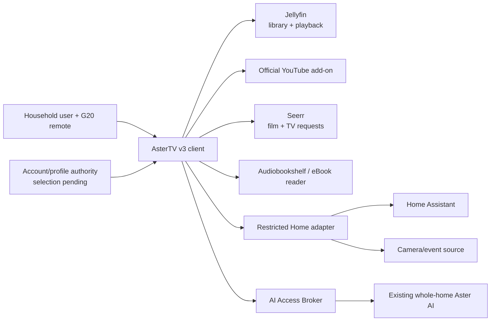

# AsterTV v3

> Status: Proposed — Stream M; project charter created, implementation not
> started
>
> Project owner: Jason
>
> Proposed: 2026-10-31
>
> Authorization stream: Stream M — every live state change and external write
> requires a fresh, bounded approval

## Purpose and desired outcome

Develop AsterTV v3 as a private, account-aware household interface that brings
the existing whole-home Aster AI, media, books, music, news, requests and Home
Assistant together without making Kodi, Aster or automation an undocumented
single point of failure.

The user-visible outcome is a coherent remote-first television experience with:

- the existing whole-home Aster AI available through a clear, cancellable TV
  interaction;
- system-wide household accounts plus a deliberately isolated guest mode;
- richer movie details and cast/crew discovery;
- a redesigned YouTube experience with safe guest access;
- better eBook pronunciation and accurately timed single-word follow-along;
- consistent Aster iconography on News;
- podcast discovery and requests;
- a more informative Home page and a separate camera page, including an
  explicitly enabled continuous feed and safe door-event previews;
- page-aware media and music idle presentations; and
- an evidenced low-spec hardware baseline.

V3 must preserve the accepted v2 navigation, playback, Dolby/HDR, recovery and
privacy behaviour unless a replacement passes the same or stronger gate.

## Current state and evidence

### Accepted v2 baseline

- AsterTV v2.0.7 is frozen in
  `services/kodi/dist/astertv-v2.0.7-release-2026-10-31.tar.gz` with SHA-256
  `e813de8a74af769ebbfeb744ad65249760292f647dc2d91c4bafb9fc7ba83cf7`.
- Git commit `47005298bbaf058de8427342e54deb3e1878c0f5` records the
  release builder, manifest, regression gates and deployment evidence.
- **AsterTV Family** is the production client at `192.168.1.157`, system
  hostname `AsterTV-Family`.
- **AsterTV Bedroom** is the current lab/baseline client at `192.168.1.140`,
  system hostname `AsterTV-Bedroom`.
- Both clients run the same 577-file Aster-owned snapshot, 24-hour clock and
  Aster media-art screensaver. Family retains verified HDMI 0 Dolby/HDR
  passthrough with PulseAudio persistently masked; Bedroom retains its supported
  stereo route.
- The v2 release gate contains 21 reconciliation tests plus focused Genre,
  Resume and media-screensaver gates. Recovery checkpoints and the prior v1.1.1
  Family baseline remain available.

### Existing service boundaries

- Jellyfin remains the film, television and music library/playback authority.
- Seerr remains the film/television household request authority.
- Audiobookshelf remains the audiobook, podcast and listening-progress
  authority; the eBook reader consumes prepared narration generations without
  packaging credentials.
- The deployed eBook narration path uses the canonical Aster Kokoro voice and
  exact sentence timing. Earlier word-level experiments did not meet the real-
  book timing gate and were not promoted.
- The official Kodi YouTube add-on provides the signed-in account's
  recommendations, Subscriptions, Watch Later and search. V2 deliberately does
  not copy YouTube credentials between clients.
- Home Assistant is the household-state authority. Camera imagery is exposed
  to AsterTV through a restricted source path; it is not ordinary media-library
  content.
- The existing whole-home Aster AI is a separate, established system. V3 will
  integrate through its reviewed service and broker boundaries rather than
  embedding a new model or copying its credentials into Kodi.
- A tentative low-spec test machine is expected on 2026-11-01: likely a
  fourth-generation Intel Core i5 with 8 GB RAM and a 240 GB SSD. CPU, GPU,
  firmware, network and display outputs are unverified.

Reconfirm all live versions, endpoints, account capabilities and hardware facts
in Milestone 0; this document does not turn remembered state into authority.

## Scope and permitted local work

Stream M permits read-only discovery, project/design work, local candidates,
tests and local commits under the repository standard. After a fresh bounded
approval, the project may:

- create a replaceable v3 candidate on the new low-spec test client or another
  explicitly selected lab target;
- extend the Aster skin and owned Kodi add-ons for the approved v3 features;
- define and implement a least-privilege Aster AI client path;
- add account/profile selection and per-account data separation;
- redesign Movies, YouTube, Books, News, Requests and Home/camera surfaces;
- add a page-aware Music idle presentation to the existing Aster screensaver;
- create narrow service identities, broker capabilities and private network
  paths needed by accepted features;
- add regression, performance, security, recovery and user-workflow tests;
- freeze an immutable v3 candidate and deploy it Lab first, then Family only
  after explicit acceptance and promotion approval; and
- reconcile Doctor, Beszel, NetBox, backup, operational reference, wiki and the
  derived Aster knowledge mirror where those systems own affected facts.

## Explicit exclusions

- No public ingress, WAN port forward, public camera URL or broader Home
  Assistant trust path.
- No production-first development and no writable code/configuration shared
  between Lab and Family.
- No copying Family, Bedroom, YouTube, Aster, Home Assistant or camera
  credentials into a new client, Git, prompts or release artifacts.
- No automatic media acquisition from an AI response. Requests remain explicit
  user actions and use the authority for that media type.
- No camera recording, facial recognition, person identification or new
  retention policy merely to support a TV preview.
- No unbounded always-on microphone, hidden recording or wake-word capture.
- No door-event pop-up that silently overrides protected playback, ignores
  quiet hours or exposes a camera to an unauthorized account.
- No inferred word timing presented as exact narration alignment.
- No replacement of Jellyfin, Seerr, Audiobookshelf, Home Assistant, Frigate or
  the existing whole-home Aster AI under this charter.
- No automatic firmware, LibreELEC, Kodi, add-on or model upgrades.
- No tag, Forgejo/GitHub release, remote workflow mutation or Git push without
  the repository's required immediate confirmation.

## Authority model

| Fact or action | Authority |
|---|---|
| V3 scope, decisions, milestones, risks and evidence | This project document and its Git history |
| Accepted v2 code, release bytes and rollback contract | Commit `47005298`, v2 release manifest and reconciliation record |
| Installed client state and hardware capability | The named client's live, sanitized evidence |
| Film, TV and music library/playback state | Jellyfin |
| Film and television requests | Seerr |
| Audiobook/podcast catalogue and progress | Audiobookshelf |
| eBook catalogue | Adopted Calibre/CWA metadata source; confirm exact read boundary in M0 |
| eBook narration readiness | Accepted narration-generation manifest and ready-generation store |
| YouTube identity, subscriptions and watch lists | Google/YouTube account exposed through the official Kodi add-on |
| Household identity and profile mapping | The identity design selected in M1; no authority is assumed yet |
| Household entities, state and automations | Home Assistant |
| Camera events and imagery | Frigate/camera source plus Home Assistant event state, as deployed |
| Aster AI answers, capabilities and approvals | Existing Aster service, AI Access Broker and their governing projects |
| Device, address, interface and service inventory | NetBox |
| Credentials | Central secrets system and source service; values never enter Git or project evidence |
| Human operation and recovery | Human wiki/runbook after handover acceptance |
| Derived Aster knowledge | Aster mirror, explicitly non-authoritative and provenance-labelled |

AsterTV is a presentation and interaction client. It must not overwrite a
source because its cached view disagrees with that source.

## Proposed architecture and data flows

Initial trust rules:

| Flow | Initial v3 state | Expansion gate |
|---|---|---|
| User to AsterTV | Local remote interaction | Account selection must remain operable offline with documented recovery |
| AsterTV to Aster AI | Denied until client contract is reviewed | Dedicated identity, exact broker capabilities, cancellation and content-free audit tests |
| AsterTV to YouTube guest | Not implemented | Prove profile isolation and primary-account non-disclosure before acceptance |
| AsterTV to requests | Existing film/TV Seerr path only | Podcast provider and duplicate/idempotence contract selected before writes |
| AsterTV to Home Assistant | Existing restricted display data | Add only exact entities/events needed by the redesigned page |
| AsterTV to camera source | Existing bounded still path | Live feed and door preview require account, quiet-hour, timeout and playback gates |
| Narration generation to local AI stack | Existing registered workloads only | Every exclusive workload requires a verified Lab Hours reservation plus lease and shared lock |

## Privacy and security design

- Keep account mappings, watch/listening history, YouTube state, household
  presence and camera access separated by explicit profile rules.
- A guest profile must not expose or mutate the primary user's YouTube history,
  subscriptions, Watch Later, requests, books, Home controls or camera access.
- Prefer broker/proxy execution so AsterTV never receives Aster AI credentials.
  Use a dedicated `ai-*` identity and minimum capability set if supported.
- Display visible listening, processing, speaking, cancelled and failed states.
  Microphone capture must be user-initiated unless a separately reviewed wake-
  word design is accepted; recordings are not retained by default.
- Door previews must be opt-in, account-authorized, labelled by source, bounded
  by timeout, immediately dismissible and subject to quiet hours. Default policy
  during playback is non-interrupting notification; any overlay exception needs
  explicit acceptance and test evidence.
- A continuously visible camera feed is permitted only on an explicitly chosen
  display/profile and must not become a globally available route.
- Minimize logs: keep timing, state and error codes, not spoken phrases, titles,
  account identifiers, camera images or household entity values unless an
  accepted diagnostic requires a protected short-lived capture.
- Keep all credentials and recovery material out of release packages. Packages
  carry schemas and non-secret identity metadata only.
- Use the Aster internal UI style guide for all surfaces, adapted to Kodi's
  remote/10-foot constraints and the accepted green/gold/stone AsterTV language.
- Any speech produced on Aster's behalf uses canonical Kokoro ONNX
  `kokoro-v1.0.fp16.onnx`, `bm_daniel`, `en-gb`, speed `0.95`, sentence/clause
  synthesis and the shared cleanup rules. A different voice requires an
  explicit decision and listening comparison.

## Pre-start risk assessment

| Risk | Likelihood / impact | Required control and residual risk |
|---|---|---|
| System-wide accounts leak one person's history or controls to another | Medium / High | Define a field-level profile matrix, guest-denial tests, clean-session switching and recovery admin. Some shared-library metadata remains inherently household-visible. |
| Guest YouTube uses or changes the primary account | Medium / High | Validate the official add-on's actual multi-profile capability; use separate profile storage or reject guest sign-in if isolation cannot be proved. |
| Aster AI integration exposes private context or gains excess authority | Medium / High | Dedicated broker identity, minimal tools, content-free audit, cancellation and prompt-injection/denied-action tests. Residual model error remains visible and non-authoritative. |
| Camera or door preview exposes private imagery | Medium / High | No public route, explicit account entitlement, quiet hours, short timeout, no default retention and denial tests from guest/unauthorized profiles. |
| Door pop-up disrupts playback or becomes nuisance automation | Medium / Medium | Non-interrupting default, debounce, rate limit, timeout, mute/quiet mode and direct playback regression. |
| Word highlighting drifts from real narration | High / Medium | Use measured word timestamps from actual output; reject/invalidate a generation outside tolerance and retain sentence fallback. |
| TTS pronunciation changes damage accepted books | Medium / Medium | Versioned lexicon, representative listening corpus, canonical cleanup regression and per-generation manifest/rollback. |
| Podcast requests create duplicates or bypass subscription ownership | Medium / Medium | Select one request/subscription authority, stable IDs, duplicate-aware preview, explicit final action and reversible test feed. |
| Large skin rewrite repeats v2 navigation regressions | Medium / High | One bounded surface at a time, immutable v2 baseline, focus-graph tests, physical G20 walkthrough and cross-page regression suite at every milestone. |
| Low-spec client produces misleading capability conclusions | Medium / Medium | Confirm exact hardware, measure rather than infer, separate hardware limit from software defect and retain Family/Bedroom acceptance. |
| Page-aware screensaver shows private Home/camera state | Low / High | Only allowlisted media/music artwork; fail closed to black Aster mark; never camera, Home, account or title-history metadata. |
| Local AI/TTS workload competes with protected lab work | Medium / High | Registered hash-pinned workload, authoritative Lab Hours window check/reservation, whole-host lease and shared lock; fail closed if any control is unavailable. |
| Production promotion causes loss of sound, Dolby/HDR or navigation | Medium / High | Lab-first immutable release, playback-idle precondition, profile/audio checkpoint, reboot validation, user acceptance and tested v2 rollback. |

No destructive or irreversible operation is required for design or Lab
development. A checkpoint failure, unexpected credential disclosure, undeclared
outbound path, unexplained source mutation, camera exposure, profile crossover,
unavailable Lab Hours ledger or loss of v2 rollback is an immediate stop.

Expected interruption is limited to the selected lab client during approved
deployments. Family interruption requires a separate promotion approval,
playback-idle evidence and a stated maintenance window.

## Persistence and resume plan

This project is the durable state record. Before any long-running or risky step,
record the current milestone, exact candidate/commit, target, checkpoint,
validation state, blocker and next safe action in the evidence log.

On resume:

1. re-read `AGENTS.md`, `docs/Project-Creation-Standard.md` and this project;
2. inspect Git status and preserve unrelated work;
3. verify the v2 archive/hash and both retained v2 rollback paths;
4. recheck the live identity, Kodi/LibreELEC version and audio state of the
   intended target;
5. verify the latest accepted v3 candidate manifest and evidence rather than
   replaying completed work;
6. check Lab Hours before proposing or starting any exclusive local-AI/TTS
   workload; and
7. continue from the first unchecked gate only.

Candidate installs must be idempotent, hash-pinned, checkpointed and atomic.
Partial generations or packages remain invisible to users. Jobs use bounded
retries, timeouts, locks and durable status; process absence is never success.

## Milestones

### M0 — Baseline discovery and decision register

- [ ] Reconfirm Family, Bedroom and the new low-spec machine hardware, OS,
  Kodi, add-ons, routes, audio/video capabilities and recovery state.
- [ ] Inventory existing Aster AI, account, YouTube, Seerr, Audiobookshelf,
  eBook narration, Home Assistant and camera contracts without reading secrets.
- [ ] Capture v2 user workflows and focus graphs as regression fixtures.
- [ ] Decide the account authority, profile data matrix, podcast request
  authority, YouTube guest feasibility and camera event source.
- [ ] Refresh this risk assessment and record unresolved owner decisions.

Gate: no v3 live mutation; an evidence-backed architecture and decision register
identify every authority, credential class and unsupported assumption.

### M1 — Low-spec lab foundation and release harness

- [ ] Confirm the new machine's exact CPU/GPU/RAM/storage/display/network facts
  and reconcile its NetBox record before configuration.
- [ ] Install the accepted v2 release as a credential-free baseline using a
  dedicated test identity and checkpoint.
- [ ] Measure boot, navigation, artwork, 1080p playback, screensaver, memory,
  storage and reboot behaviour.
- [ ] Create the v3 branch/build manifest, package validator and automatic v2
  rollback path without modifying Family.

Gate: the low-spec client can be rebuilt from documented inputs and restored to
the accepted v2 baseline; its measured limits are recorded honestly.

### M2 — Accounts, profiles and guest isolation

- [ ] Define system-wide account/profile schema, switching UX, recovery admin,
  shared versus private state and service mappings.
- [ ] Implement accounts first with synthetic users and no production tokens.
- [ ] Prove account switching, restart persistence, sign-out, missing identity,
  malformed state and guest denials.
- [ ] Test that guest mode cannot access primary YouTube state, requests, books,
  Home controls, cameras or Aster private context.

Gate: two synthetic accounts and guest remain isolated across restart and
adversarial navigation; recovery does not require the implementation agent.

### M3 — Aster AI television integration

- [ ] Define the dedicated AsterTV client identity, broker tools, approval class,
  secret custody metadata, rotation/revocation and break-glass path.
- [ ] Build visible listen/process/respond/cancel/error states using the G20
  microphone or a synthetic capture fixture first.
- [ ] Apply account context only after authorization and data-minimization tests.
- [ ] Test prompt injection, unavailable broker/model, timeout, cancellation,
  stale context, denied tools and restart during a request.
- [ ] Validate spoken output against the canonical Aster voice and cleanup.

Gate: AsterTV can complete two independent bounded Aster interactions without
receiving credentials, exposing another profile or obtaining general admin
authority.

### M4 — Movies and YouTube redesign

- [ ] Restyle the movie landing/details page while preserving details-before-
  playback, Resume, Back and Search return behaviour.
- [ ] Add cast/crew artwork, names and roles plus cast/crew search that retains
  current-movie context.
- [ ] Restyle YouTube with consistent artwork, pills, focus and return paths.
- [ ] Preserve recommendations, thumbnails, Subscriptions, Watch Later and
  search, then implement guest access only if M0/M2 isolation is proven.
- [ ] Run physical G20 focus/Back/playback tests from every entry route.

Gate: visual acceptance plus complete focus graph; no autoplay regression,
primary-account leak or loss of existing YouTube functions.

### M5 — Books, News and podcast requests

- [ ] Version and test an expanded pronunciation lexicon against representative
  real books while preserving current Aster corrections.
- [ ] Produce measured single-word timestamps from actual canonical narration;
  reject drift and retain sentence fallback.
- [ ] Add Aster icons to News pills without changing digest selection, reading,
  playback or shared chrome.
- [ ] Extend Requests to podcasts through the selected authority with stable
  IDs, preview, duplicates, status and explicit submission.
- [ ] Book every exclusive local-AI/TTS run through Lab Hours and retain
  workload/lease/lock evidence without secrets.

Gate: real-book listening and timing acceptance, News regression pass and one
synthetic/reversible podcast request path with no duplicate side effect.

### M6 — Home dashboard, cameras and door events

- [ ] Design a denser but remote-readable Home page using an explicit allowlist
  of Home Assistant entities and freshness/failure states.
- [ ] Build a separate Cameras page with named still/live sources, refresh state
  and reliable Back navigation.
- [ ] Add optional continuous feed mode for an explicitly authorized profile and
  display only.
- [ ] Add debounced door-event preview with source, timeout, dismiss, open-
  camera action, quiet hours and non-interrupting playback default.
- [ ] Test guest denial, stale/forged event, camera outage, HA outage, event
  storm, playback and immediate privacy disable.

Gate: approved accounts see only allowed entities/cameras; denials and failures
are explicit; playback and network isolation remain intact.

### M7 — Page-aware idle presentation and visual reconciliation

- [ ] Retain the accepted balanced TV/movie presentation.
- [ ] Add a Music presentation using random album artwork when the last active
  page is Music, with the AsterTV mark bottom right.
- [ ] Define neutral fallbacks for other pages and unknown state.
- [ ] Verify burn-in movement, wake return, playback/Home-timer suppression and
  absolute exclusion of cameras, household/account data and sound.
- [ ] Review every changed surface against the Aster internal UI guide and
  accepted AsterTV green/gold/stone interaction language.

Gate: page-aware behaviour is deterministic, private and reversible, with a
black branded fallback on missing or malformed artwork.

### M8 — Integrated validation, recovery and efficiency review

- [ ] Run functional, account-isolation, failure, security, focus/navigation,
  playback, audio/video and secret-pattern suites on the low-spec client.
- [ ] Prove interrupted install, corrupt package, dependency outage, reboot and
  full v2 rollback.
- [ ] Measure CPU, GPU, RAM, storage, page latency, artwork latency, network
  traffic, camera stream cost, speech latency and idle overhead.
- [ ] Complete Doctor, Beszel, backup/restore, NetBox, wiki, reference, mirror
  and AI-administration integration work.
- [ ] Complete a non-author walkthrough and correct avoidable friction.

Gate: two clean full-path passes, isolated restore, v2 rollback and documented
resource headroom; every deviation is fixed or explicitly accepted.

### M9 — Immutable release, Bedroom soak and Family promotion

- [ ] Freeze v3 as an identified commit plus reproducible manifest containing
  code, dependencies, schemas and material asset hashes.
- [ ] Deploy independently to Bedroom, preserving its v2 recovery checkpoint,
  credentials and stereo configuration; soak through reboot and normal use.
- [ ] Obtain explicit Family promotion approval after Bedroom acceptance and
  confirm playback is idle.
- [ ] Deploy independently to Family, preserving its v2 checkpoint, account
  state and verified HDMI 0 Dolby/HDR contract.
- [ ] Complete the user-facing handover, final intent/efficiency review, project
  records, focused commit and separately authorized Forgejo push/mirror check.

Gate: Jason accepts the household workflow on both targets; stopping Aster AI,
Home/cameras or any optional integration degrades clearly without breaking core
local media playback or recovery.

## Validation and evaluation matrix

| Class | Required evidence |
|---|---|
| Functional | Every named feature works from all intended entry points using the physical remote |
| Navigation | Explicit focus graph, OK/Menu/Back behaviour, return cursor and no inert controls on every changed page |
| Accounts | Cross-profile reads/writes denied, guest isolation, clean switch, restart persistence and recovery admin |
| AI | Dedicated broker identity, denied tools, cancellation, prompt injection, dependency failure and two independent passes |
| Speech | Canonical voice/settings, pronunciation corpus and measured word-alignment tolerance with sentence fallback |
| Privacy | No secret, phrase, image, household value or other account's behavioural state in logs, packages or UI |
| Cameras | Account entitlement, quiet hours, stale/forged event, outage, storm, dismiss and playback tests |
| Media regression | Jellyfin playback, Resume, Intro/Recap/Outro, Search, TV seasons, Movies, Music, Books, News, YouTube and Requests |
| AV regression | Family Dolby/HDR HDMI 0 after reboot; Bedroom/low-spec supported stereo/video behaviour preserved |
| Failure/recovery | Interrupted promotion, corrupt state, missing dependency, restart, rollback and isolated restore |
| Performance | Low-spec and normal-client CPU/GPU/RAM/storage/latency/network measurements with accepted budgets |
| Accessibility | 10-foot readability, visible focus, non-colour status, remote target sizing and no clipped text |

## Observability and maintenance

- Add Doctor checks for release drift, required add-ons, account-store health,
  broker/camera/Home adapter health and backup age using non-secret output.
- Reconcile all three clients in Beszel. Avoid duplicate alerts where Kodi/
  service-native health or Doctor already owns a failure mode.
- Record client CPU/RAM/storage/temperature and restart trends sufficient to
  identify the low-spec floor without collecting viewing history.
- Alert ownership remains Jason. Door/camera availability should not page unless
  explicitly chosen; core client/release drift and backup failures should be
  actionable.
- No automatic release/model/add-on upgrade. Review upstream changes, rebuild
  the immutable candidate, rerun gates and soak in Lab.
- Any recurring narration or AI job must record its registered workload,
  reservation, last success, bounded failure and concurrency controls.

## Backup, restore and rollback

- Retain the immutable v2 archive, manifest, commit, Family/Bedroom checkpoints
  and exact audio profiles until v3 graduates and its rollback has been tested.
- Protect v3 code, non-secret schemas, profile/account mapping state, user
  preferences, narration manifests/lexicon, Home/camera adapter configuration
  and system service definitions according to sensitivity.
- Keep service credentials in central secret custody and document rotation/
  revocation without values. A release restore must require reprovisioning, not
  contain the secret.
- Restore proof uses an isolated/disposable client or network-denied target
  first. Verify login/profile separation, navigation, playback and database/
  state integrity before reconnecting service paths.
- Rollback replaces only Aster-owned code/configuration from the accepted v2
  package, restores the target's own pre-v3 profile/audio/service checkpoint,
  restarts Kodi and validates no active player, sound, clock, screensaver,
  navigation and recovery-marker state.
- Revoke new v3 identities and remove narrow network paths if the project is
  abandoned. Do not delete household source data as rollback.

## Documentation and systems-of-record updates

| Integration | Required project treatment |
|---|---|
| HomeLab Doctor | Add non-secret client/release, adapter, account-store and backup-age checks; test failure output. |
| Monitoring/alerting | Reconcile Beszel names/agents for every client, including the low-spec device; document alert ownership and deliberate exclusions. |
| Backup and recovery | Add protected v3 state and exact restore order; prove isolated restore and v2 rollback. |
| NetBox | Reconcile Family, Bedroom and the new low-spec device/interface/MAC/IP/service facts through the API. |
| Human wiki | Publish AsterTV account, AI, media, Home/camera, privacy and recovery operator guidance. |
| Aster mirror/snapshot | Publish only salient, provenance-labelled non-secret operation/recovery knowledge after human docs are accepted. |
| Operational reference/runbooks | Record current client identities, release/hash, audio profiles, deployment, rollback and failure procedures. |
| Repository documentation | Maintain this project, release manifest, tests, package notes, portfolio, roadmap and changelog. |
| Diagrams/rack records | Update only if the new physical client or cabling is an adopted topology fact; otherwise record not applicable. |
| Homepage/service discovery | Not currently planned: AsterTV is a local appliance rather than a browser service. Reassess if a private admin UI is added. |
| Authentication/authorization | Define account authority, guest isolation, recovery admin, Aster broker identity and per-service mapping. |
| DNS/certificates/firewall | No new public path. Add only exact private records/rules required by accepted adapters and prove denial outside them. |
| Automation/schedules | Register narration/AI jobs; enforce Lab Hours, lease and lock requirements; document missed-run and last-success state. |
| Security inventory | Record secret custody identifiers, modes, temporary access removal, patch responsibility and rotation/revocation. |
| AI administration | Prefer a dedicated brokered `ai-astertv` identity with allowlisted capabilities; if unsupported, record human-only administration rather than weaken security. |

## User-facing handover

Before graduation, publish and walk through a concise AsterTV v3 guide that:

- identifies what changed from v2 and what remains deliberately unchanged;
- explains profile switching, guest limitations and account recovery;
- explains Aster listening/processing/cancel/error indicators and what Aster can
  and cannot do;
- covers Movies/cast search, YouTube, Books narration, News, Requests, Home,
  Cameras, door previews and screensaver behaviour;
- states which information is private/shared and how to disable microphone,
  camera preview, continuous feed and door pop-ups;
- explains common failure messages, offline/degraded behaviour and safe
  recovery to v2; and
- records any manual account/device-code authentication Jason must complete
  outside chat.

Graduation requires a physical-remote walkthrough on Bedroom and Family plus
explicit user acceptance.

## Graduation criteria

- Every milestone gate is evidenced and all required integration items are
  complete or explicitly not applicable with reason.
- The immutable release is reproducible from Git and contains no credentials,
  profile data, recordings, camera images or household state.
- Account and guest isolation, camera privacy, Aster broker authority and
  canonical speech pass adversarial and recovery tests.
- The low-spec baseline has measured, documented limits and does not lower the
  Family/Bedroom acceptance standard.
- Bedroom and Family each pass two full production-path runs plus reboot; Family
  retains accepted Dolby/HDR and Bedroom retains working sound.
- Backup/isolated restore and v2 rollback are exercised, not merely described.
- Doctor/Beszel/NetBox/wiki/reference/mirror state agrees with deployment.
- The post-deployment intent and efficiency review confirms that every created
  integration delivers the desired user outcome without avoidable resource,
  latency, permission, storage, reliability or operational cost.
- Jason completes and accepts the user-facing walkthrough.
- No unexplained temporary identity, firewall rule, credential, candidate,
  recovery marker or working-tree state remains.

## Evidence log

| Date | Action | Evidence | Result / next safe action |
|---|---|---|---|
| 2026-10-31 | Established v3 backlog | Owner supplied eight feature groups; existing screensaver and low-spec items retained | Backlog converted into this project charter |
| 2026-10-31 | Recorded accepted predecessor | v2.0.7 archive SHA-256 `e813de8a…3cf7`, commit `47005298`, 21 tests plus focused gates, dual-target deployment evidence | V2 is the immutable baseline and rollback source |
| 2026-10-31 | Selected authorization model | Accounts, Aster AI, microphone, cameras and production playback create high privacy/availability coupling | Stream M selected; no v3 live mutation authorized by project creation |
| 2026-10-31 | Project integration | Added portfolio/roadmap/changelog records; retained the old wish list byte-for-byte because it is hash-pinned in the accepted v2 package | This project is authoritative; next safe action is M0 read-only discovery and owner decisions |

## Close-out

Not started. At completion, replace this section with the final architecture,
release/commit/hash, deployed identities, account authority, service and secret
ownership, recovery references, observed resource envelope, accepted residual
risks and deliberately deferred v4 work. Move the project only after all links
and systems of record are reconciled.
