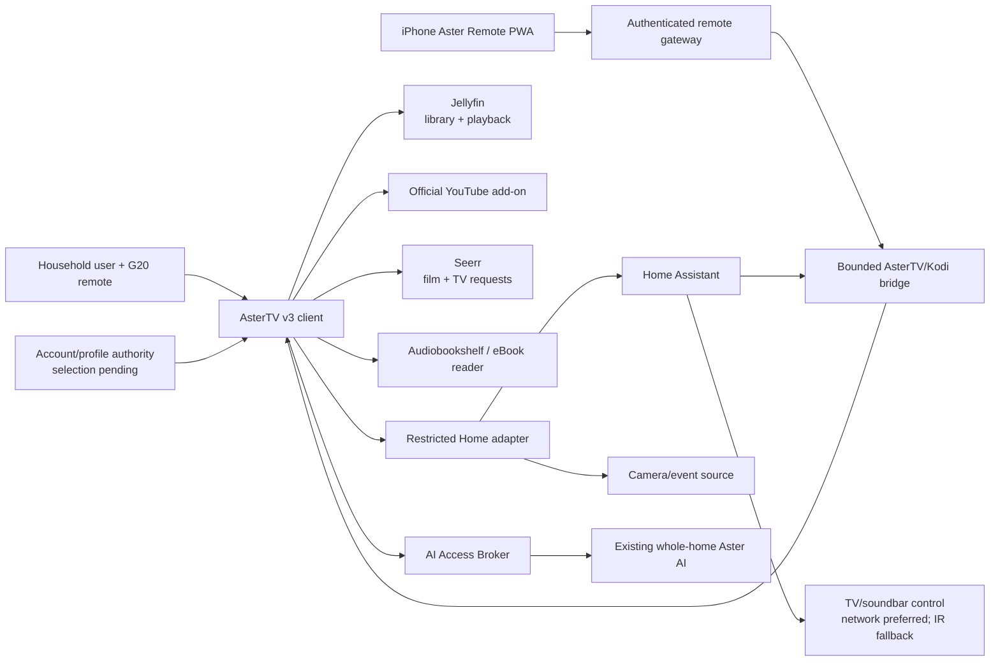

# AsterTV v3

> Status: Active — Jen-only M2 synthetic-account Stream A approved. The
> earlier page-design pilot is accepted and closed; no PA3 synthetic
> surface is promoted. TV-series presentation remains deployed through the
> existing fail-closed v2 episode engine on Bedroom and Family.
>
> Project owner: Jason
>
> Proposed: 2026-10-31
>
> Current authorization stream: Stream A, limited to the Jen-only M2 envelope
> recorded below and accepted by Jason on 2026-11-04. Family, Bedroom, source
> services, production identities and every later milestone remain Stream M.

## Purpose and desired outcome

Develop AsterTV v3 as a private, account-aware household interface that brings
the existing whole-home Aster AI, media, books, music, news, requests and Home
Assistant together without making Kodi, Aster or automation an undocumented
single point of failure.

The user-visible outcome is a coherent remote-first television experience with:

- the existing whole-home Aster AI available through a clear, cancellable TV
  interaction;
- system-wide household accounts plus a deliberately isolated guest mode;
- richer movie details and cast/crew discovery;
- a redesigned YouTube experience with safe guest access;
- better eBook pronunciation and accurately timed single-word follow-along;
- consistent Aster iconography on News;
- podcast discovery and requests;
- a more informative Home page and a separate camera page, including an
  explicitly enabled continuous feed and safe door-event previews;
- a least-privilege Home Assistant bridge for AsterTV state, playback,
  notifications and room automations, with economical TV/soundbar control;
- a free, installable iPhone Aster Remote web app for touch navigation,
  playback, search, room power and volume without App Store distribution;
- page-aware media and music idle presentations; and
- an evidenced low-spec hardware baseline.

V3 must preserve the accepted v2 navigation, playback, Dolby/HDR, recovery and
privacy behaviour unless a replacement passes the same or stronger gate.

## Current state and evidence

### Accepted v2 baseline

- AsterTV v2.0.7 is frozen in
  `services/kodi/dist/astertv-v2.0.7-release-2026-10-31.tar.gz` with SHA-256
  `e813de8a74af769ebbfeb744ad65249760292f647dc2d91c4bafb9fc7ba83cf7`.
- Git commit `47005298bbaf058de8427342e54deb3e1878c0f5` records the
  release builder, manifest, regression gates and deployment evidence.
- **AsterTV Family** is the production client at `192.168.1.157`, system
  hostname `AsterTV-Family`.
- **AsterTV Bedroom** is the current lab/baseline client at `192.168.1.140`,
  system hostname `AsterTV-Bedroom`.
- The Family display chain includes a TCL QM8L Google TV and an Onkyo TX-RZ30
  9.2-channel receiver. The receiver supports network standby and direct local
  Home Assistant control; the television exposes Google/Android TV remote
  control and CEC/eARC settings. Reconfirm exact addresses, firmware, cabling
  and enabled standby controls in M0.
- Both clients run the same 577-file Aster-owned snapshot, 24-hour clock and
  Aster media-art screensaver. Family retains verified HDMI 0 Dolby/HDR
  passthrough with PulseAudio persistently masked; Bedroom retains its supported
  stereo route.
- A fresh read-only Family check on 2026-10-31 reports Kodi 22.0 RC1
  (`21.90.901`), Git `01d4146d5d251a0118b99a1de0d713395c93bd46`, on
  LibreELEC 13 nightly `20261021-440640e`. Bedroom did not answer SSH during
  that check and remains a PA0 re-verification item; the Mini pilot must match
  the confirmed Family Kodi release rather than the Mini's retained Kodi 21.3
  profile.
- The v2 release gate contains 21 reconciliation tests plus focused Genre,
  Resume and media-screensaver gates. Recovery checkpoints and the prior v1.1.1
  Family baseline remain available.
- Both live clients now also carry the host-bound AsterTV reliability guard.
  Its persistent Kodi service can clear only the volatile Music recovery latch,
  and only after three consecutive idle-and-empty player/playlist reads plus a
  final read. It cannot stop playback or mutate playlists, and it retains every
  queue-intent/checkpoint journal. A pre-Kodi systemd unit verifies an accepted
  copy outside the add-on tree and atomically restores only changed/missing
  accepted files; it excludes userdata, credentials, databases and caches and
  never deletes extra files. Bedroom accepted 535 files and Family 533 files.

The measured AsterTV-Jen limits are deliberately **client-specific**. Its
1920x1080, 18 Mb/s, HDMI-stereo and no-passthrough profile describes only the
Haswell low-spec test unit. It does not lower AsterTV v3's product capability,
change Family's Dolby/HDR contract, or change Bedroom's independently measured
audio/video contract. V3 selects presentation and playback policy from a
measured client-capability profile rather than a global low-spec ceiling.

### Existing service boundaries

- Jellyfin remains the film, television and music library/playback authority.
- Seerr remains the film/television household request authority.
- Audiobookshelf remains the audiobook, podcast and listening-progress
  authority; the eBook reader consumes prepared narration generations without
  packaging credentials.
- The deployed eBook narration path uses the canonical Aster Kokoro voice and
  exact sentence timing. Earlier word-level experiments did not meet the real-
  book timing gate and were not promoted.
- The official Kodi YouTube add-on provides the signed-in account's
  recommendations, Subscriptions, Watch Later and search. V2 deliberately does
  not copy YouTube credentials between clients.
- Home Assistant is the household-state authority. Camera imagery is exposed
  to AsterTV through a restricted source path; it is not ordinary media-library
  content.
- The existing whole-home Aster AI is a separate, established system. V3 will
  integrate through its reviewed service and broker boundaries rather than
  embedding a new model or copying its credentials into Kodi.
- A tentative low-spec test machine is expected on 2026-11-01: likely a
  fourth-generation Intel Core i5 with 8 GB RAM and a 240 GB SSD. CPU, GPU,
  firmware, network and display outputs are unverified.
- In lieu of that unavailable machine, Jason selected the M4 Mac mini as the
  immediate page-redesign pilot. Read-only discovery on 2026-10-31 found macOS
  26.6.2 on `Mac16,10` with 16 GB RAM, a retained Kodi 21.3 ARM profile last
  used in October, Aster skin/add-ons versioned `1.0.0`, and no current
  `/Applications/Kodi.app` or `~/Applications/Kodi.app`. The retained skin is
  an earlier prototype with substantial drift from the accepted v2 payload;
  it is evidence only and must not become the v3 source of truth.

Reconfirm all live versions, endpoints, account capabilities and hardware facts
in Milestone 0; this document does not turn remembered state into authority.

## Scope and permitted local work

The repository's common project authorization permits read-only discovery,
project/design work, local candidates, tests and local commits. After the
applicable Stream A envelope or a fresh bounded Stream M approval, the project
may:

- create a replaceable v3 candidate on the new low-spec test client or another
  explicitly selected lab target;
- extend the Aster skin and owned Kodi add-ons for the approved v3 features;
- define and implement a least-privilege Aster AI client path;
- add a bounded Home Assistant bridge for Kodi/AsterTV state, commands and
  events, plus model-verified television and soundbar control;
- build a local-first Progressive Web App (PWA) remote backed only by that
  bounded bridge, with no Kodi or Home Assistant credential shipped to the
  browser;
- add account/profile selection and per-account data separation;
- redesign Movies, YouTube, Books, News, Requests and Home/camera surfaces;
- add a page-aware Music idle presentation to the existing Aster screensaver;
- create narrow service identities, broker capabilities and private network
  paths needed by accepted features;
- add regression, performance, security, recovery and user-workflow tests;
- freeze an immutable v3 candidate and deploy it Lab first, then Family only
  after explicit acceptance and promotion approval; and
- reconcile Doctor, Beszel, NetBox, backup, operational reference, wiki and the
  derived Aster knowledge mirror where those systems own affected facts.

During the historical page-design Stream A pilot only, the project could install an
official hash-recorded Kodi 22.0 RC1 ARM application in a dedicated writable Mini
pilot location, always launch it in portable mode, create a credential-free
synthetic AsterTV v3 data directory, deploy page candidates to that portable
instance, restart only that pilot instance, capture screenshots/navigation
evidence and restore or remove only the dedicated pilot. These autonomous
permissions do not extend to the retained Mini Kodi profile, Family, Bedroom,
Home Assistant, cameras, credentials, source services or network policy.

## Explicit exclusions

- No public ingress, WAN port forward, public camera URL or broader Home
  Assistant trust path.
- No production-first development and no writable code/configuration shared
  between Lab and Family.
- No copying Family, Bedroom, YouTube, Aster, Home Assistant or camera
  credentials into a new client, Git, prompts or release artifacts.
- No automatic media acquisition from an AI response. Requests remain explicit
  user actions and use the authority for that media type.
- No camera recording, facial recognition, person identification or new
  retention policy merely to support a TV preview.
- No unbounded always-on microphone, hidden recording or wake-word capture.
- No door-event pop-up that silently overrides protected playback, ignores
  quiet hours or exposes a camera to an unauthorized account.
- No inferred word timing presented as exact narration alignment.
- No replacement of Jellyfin, Seerr, Audiobookshelf, Home Assistant, Frigate or
  the existing whole-home Aster AI under this charter.
- No automatic firmware, LibreELEC, Kodi, add-on or model upgrades.
- No Bluetooth audio route for television playback: HDMI/DisplayPort remains
  the accepted audio/video path and must preserve the target's Dolby/stereo
  contract.
- No assumption that Bluetooth availability is a generic power, input, volume
  or state-control API. Device profiles and standby behaviour must be proved
  per model before Bluetooth control can graduate.
- No arbitrary shell, unrestricted Kodi JSON-RPC or broad Home Assistant
  service execution exposed through the bridge.
- No public remote-control endpoint, direct browser-to-Kodi credential, App
  Store dependency or paid Apple developer account.
- No promise that an iPhone Home Screen web app can intercept the phone's
  physical volume/side buttons, enter Apple Control Centre, provide native Siri
  Remote integration, remain continuously active in the background or replace
  a physical remote during a network/bridge outage.
- No tag, Forgejo/GitHub release, remote workflow mutation or Git push without
  the repository's required immediate confirmation.
- No mutation, migration or deletion of the Mini's retained
  `~/Library/Application Support/Kodi` profile during the Stream A pilot.
- No real household credentials, library databases, viewing history, Home
  Assistant state or camera imagery in the portable page-design fixture.
- No Family or Bedroom deployment, production promotion or source-service
  mutation without a fresh bounded Stream M authorization. The 2026-11-01
  TV-series-page authorization is recorded above and covers only that package.

## Authority model

| Fact or action | Authority |
|---|---|
| V3 scope, decisions, milestones, risks and evidence | This project document and its Git history |
| Accepted v2 code, release bytes and rollback contract | Commit `47005298`, v2 release manifest and reconciliation record |
| Installed client state and hardware capability | The named client's live, sanitized evidence |
| Film, TV and music library/playback state | Jellyfin |
| Film and television requests | Seerr |
| Audiobook/podcast catalogue and progress | Audiobookshelf |
| eBook catalogue | Adopted Calibre/CWA metadata source; confirm exact read boundary in M0 |
| eBook narration readiness | Accepted narration-generation manifest and ready-generation store |
| YouTube identity, subscriptions and watch lists | Google/YouTube account exposed through the official Kodi add-on |
| Household identity and profile mapping | The identity design selected in M1; no authority is assumed yet |
| Household entities, state and automations | Home Assistant |
| Kodi/AsterTV playback and application state | The named AsterTV client, represented in Home Assistant through the bounded bridge |
| TV/soundbar power, input and volume state | The device's verified native network integration where available; otherwise the selected bounded control adapter |
| Aster Remote identity, session and permitted actions | The v3 account authority plus the bounded bridge; the PWA is an untrusted presentation client |
| Camera events and imagery | Frigate/camera source plus Home Assistant event state, as deployed |
| Aster AI answers, capabilities and approvals | Existing Aster service, AI Access Broker and their governing projects |
| Device, address, interface and service inventory | NetBox |
| Credentials | Central secrets system and source service; values never enter Git or project evidence |
| Human operation and recovery | Human wiki/runbook after handover acceptance |
| Derived Aster knowledge | Aster mirror, explicitly non-authoritative and provenance-labelled |

AsterTV is a presentation and interaction client. It must not overwrite a
source because its cached view disagrees with that source.

## Proposed architecture and data flows

Initial trust rules:

| Flow | Initial v3 state | Expansion gate |
|---|---|---|
| User to AsterTV | Local remote interaction | Account selection must remain operable offline with documented recovery |
| AsterTV to Aster AI | Denied until client contract is reviewed | Dedicated identity, exact broker capabilities, cancellation and content-free audit tests |
| AsterTV to YouTube guest | Not implemented | Prove profile isolation and primary-account non-disclosure before acceptance |
| AsterTV to requests | Existing film/TV Seerr path only | Podcast provider and duplicate/idempotence contract selected before writes |
| AsterTV to Home Assistant | Existing restricted display data | Add only exact entities/events needed by the redesigned page |
| Home Assistant to AsterTV | Not yet adopted as a v3 control contract | Dedicated Kodi credential, source-restricted private path, allowlisted playback/navigation/Aster actions and denial tests |
| Home Assistant to TV/soundbar | Capability unknown by exact model | Prefer official local network integration; use learned local IR when state feedback is unnecessary; evaluate Bluetooth only after profile/standby proof; buy CEC hardware only for an uncovered requirement |
| iPhone PWA to remote gateway | Not implemented | Private HTTPS/WSS, authenticated short-lived session, account/room allowlist, rate limits, CSRF/origin checks and no embedded service credential |
| Remote gateway to Kodi/Home Assistant | Denied except allowlisted actions | Translate semantic actions such as Up, OK, Back, Play/Pause, Search, Power, Volume and Mute; never proxy arbitrary methods or service calls |
| AsterTV to camera source | Existing bounded still path | Live feed and door preview require account, quiet-hour, timeout and playback gates |
| Narration generation to local AI stack | Existing registered workloads only | Every exclusive workload requires a verified Lab Hours reservation plus lease and shared lock |

## Privacy and security design

- Keep account mappings, watch/listening history, YouTube state, household
  presence and camera access separated by explicit profile rules.
- A guest profile must not expose or mutate the primary user's YouTube history,
  subscriptions, Watch Later, requests, books, Home controls or camera access.
- Prefer broker/proxy execution so AsterTV never receives Aster AI credentials.
  Use a dedicated `ai-*` identity and minimum capability set if supported.
- Display visible listening, processing, speaking, cancelled and failed states.
  Microphone capture must be user-initiated unless a separately reviewed wake-
  word design is accepted; recordings are not retained by default.
- Door previews must be opt-in, account-authorized, labelled by source, bounded
  by timeout, immediately dismissible and subject to quiet hours. Default policy
  during playback is non-interrupting notification; any overlay exception needs
  explicit acceptance and test evidence.
- A continuously visible camera feed is permitted only on an explicitly chosen
  display/profile and must not become a globally available route.
- Minimize logs: keep timing, state and error codes, not spoken phrases, titles,
  account identifiers, camera images or household entity values unless an
  accepted diagnostic requires a protected short-lived capture.
- Keep all credentials and recovery material out of release packages. Packages
  carry schemas and non-secret identity metadata only.
- Give each AsterTV client its own Home Assistant/Kodi identity and restrict the
  network path to the Home Assistant host and the minimum required ports.
  Expose allowlisted media/navigation/Aster actions rather than a general
  command or shell endpoint.
- Treat TV/soundbar volume as room equipment control during passthrough; do not
  alter Kodi's decoded volume or route protected playback over Bluetooth.
- For automatic volume, AsterTV reports an explicit coarse content class rather
  than forcing Home Assistant to infer custom News/Books playback from fragile
  metadata. Apply room-specific targets only at playback start or class change,
  ramp changes, cap nighttime levels, retain unknown content volume and suspend
  automation after a manual adjustment for the rest of that session.
- Treat the PWA as an untrusted client. Keep service credentials server-side,
  require an authenticated household session, authorize every action by room
  and profile, rate-limit commands and provide immediate session revocation.
- Use the Aster internal UI style guide for all surfaces, adapted to Kodi's
  remote/10-foot constraints and the accepted green/gold/stone AsterTV language.
- Any speech produced on Aster's behalf uses canonical Kokoro ONNX
  `kokoro-v1.0.fp16.onnx`, `bm_daniel`, `en-gb`, speed `0.95`, sentence/clause
  synthesis and the shared cleanup rules. A different voice requires an
  explicit decision and listening comparison.

## Pre-start risk assessment

| Risk | Likelihood / impact | Required control and residual risk |
|---|---|---|
| System-wide accounts leak one person's history or controls to another | Medium / High | Define a field-level profile matrix, guest-denial tests, clean-session switching and recovery admin. Some shared-library metadata remains inherently household-visible. |
| Guest YouTube uses or changes the primary account | Medium / High | Validate the official add-on's actual multi-profile capability; use separate profile storage or reject guest sign-in if isolation cannot be proved. |
| Aster AI integration exposes private context or gains excess authority | Medium / High | Dedicated broker identity, minimal tools, content-free audit, cancellation and prompt-injection/denied-action tests. Residual model error remains visible and non-authoritative. |
| Camera or door preview exposes private imagery | Medium / High | No public route, explicit account entitlement, quiet hours, short timeout, no default retention and denial tests from guest/unauthorized profiles. |
| Door pop-up disrupts playback or becomes nuisance automation | Medium / Medium | Non-interrupting default, debounce, rate limit, timeout, mute/quiet mode and direct playback regression. |
| Home Assistant bridge becomes a remote-control or command-execution backdoor | Low / High | Per-client credentials, source-restricted firewall, minimal ports, allowlisted actions, content-free audit and explicit denied-command tests. |
| Bluetooth appears cheaper but cannot wake or reliably control room equipment | Medium / Medium | Inventory exact models and advertised profiles; prove pairing, reconnect, standby wake and each command. Prefer native local network control, then IR; treat Bluetooth HID/AVRCP as experimental, not a CEC-equivalent assumption. |
| IR fallback loses state or sends a destructive toggle twice | Medium / Medium | Prefer discrete commands, correlate with network/power state, make automations idempotent and retain manual remote operation. |
| Automatic volume produces a startling jump or fights a manual adjustment | Medium / High | Per-room calibrated targets, bounded ramp, nighttime cap, playback-start/class-change triggers only, session manual-override latch, safe unknown-content behaviour and physical control fallback. |
| PWA exposes household control or becomes a general command proxy | Low / High | Private HTTPS/WSS, authenticated short-lived sessions, origin/CSRF checks, rate limits, per-room/profile authorization and a semantic allowlist with no arbitrary JSON-RPC, shell or Home Assistant service proxy. |
| iOS web-app limits are mistaken for native Apple Remote capability | Medium / Low | Document on-screen volume, foreground/reconnect and Siri/side-button limitations; keep the G20 and equipment remotes as supported fallbacks. |
| Word highlighting drifts from real narration | High / Medium | Use measured word timestamps from actual output; reject/invalidate a generation outside tolerance and retain sentence fallback. |
| TTS pronunciation changes damage accepted books | Medium / Medium | Versioned lexicon, representative listening corpus, canonical cleanup regression and per-generation manifest/rollback. |
| Podcast requests create duplicates or bypass subscription ownership | Medium / Medium | Select one request/subscription authority, stable IDs, duplicate-aware preview, explicit final action and reversible test feed. |
| Large skin rewrite repeats v2 navigation regressions | Medium / High | One bounded surface at a time, immutable v2 baseline, focus-graph tests, physical G20 walkthrough and cross-page regression suite at every milestone. |
| Mini pilot overwrites its retained Kodi profile | Low / High | Separate writable Kodi app bundle, mandatory `-p` launch wrapper, dedicated `portable_data`, preflight path assertion and untouched-profile hash/inventory comparison before and after every pilot milestone. |
| Old Mini prototype is mistaken for the accepted v2 baseline | Medium / High | Build v3 only from the immutable v2.0.7 release/payload and record overlay provenance; use the old profile only for read-only historical comparison. |
| Synthetic page design hides a broken live integration | Medium / Medium | Label every fixture, keep data adapters outside the visual contract, repeat navigation with malformed/empty/error fixtures and require later Stream M integration tests against each real authority. |
| Low-spec client produces misleading capability conclusions | Medium / Medium | Confirm exact hardware, measure rather than infer, separate hardware limit from software defect and retain Family/Bedroom acceptance. |
| Page-aware screensaver shows private Home/camera state | Low / High | Only allowlisted media/music artwork; fail closed to black Aster mark; never camera, Home, account or title-history metadata. |
| Local AI/TTS workload competes with protected lab work | Medium / High | Registered hash-pinned workload, authoritative Lab Hours window check/reservation, whole-host lease and shared lock; fail closed if any control is unavailable. |
| Production promotion causes loss of sound, Dolby/HDR or navigation | Medium / High | Lab-first immutable release, playback-idle precondition, profile/audio checkpoint, reboot validation, user acceptance and tested v2 rollback. |

No destructive or irreversible operation is required for design or Lab
development. A checkpoint failure, unexpected credential disclosure, undeclared
outbound path, unexplained source mutation, camera exposure, profile crossover,
unavailable Lab Hours ledger or loss of v2 rollback is an immediate stop.

Expected interruption is limited to the selected lab client during approved
deployments. Family interruption requires a separate promotion approval,
playback-idle evidence and a stated maintenance window.

The current Mini pilot does not interrupt either AsterTV appliance. It may open
and restart only the dedicated portable Kodi instance on the Mini. Discovery
and local candidate work can continue now; installing or launching that pilot
begins only after Jason accepts this updated pre-start risk envelope.

## Persistence and resume plan

This project is the durable state record. Before any long-running or risky step,
record the current milestone, exact candidate/commit, target, checkpoint,
validation state, blocker and next safe action in the evidence log.

On resume:

1. re-read `AGENTS.md`, `docs/Project-Creation-Standard.md` and this project;
2. inspect Git status and preserve unrelated work;
3. verify the v2 archive/hash and both retained v2 rollback paths;
4. recheck the live identity, Kodi/LibreELEC version and audio state of the
   intended target;
5. verify the latest accepted v3 candidate manifest and evidence rather than
   replaying completed work;
6. check Lab Hours before proposing or starting any exclusive local-AI/TTS
   workload; and
7. continue from the first unchecked gate only.

During the page pilot, also verify branch `codex/astertv-v3`, the official Kodi
artifact digest, the portable launch assertion and the retained Mini-profile
integrity record before opening the pilot.

Candidate installs must be idempotent, hash-pinned, checkpointed and atomic.
Partial generations or packages remain invisible to users. Jobs use bounded
retries, timeouts, locks and durable status; process absence is never success.

## Stream transition and page-redesign pilot

The project has exactly one active authorization stream at a time. The bounded
PA0–PA4 page pilot below is historical and closed. Its authority did not carry
forward. A later, separately approved repository-only Stream A envelope is
defined after PA4.

### PA0 — Mini pilot foundation

- [x] Record the official Kodi 22.0 RC1 ARM download URL, digest and
  provenance evidence. The macOS ARM artifact is
  `kodi-22.0-Piers_rc1-arm64.dmg`, official SHA-256
  `5f50e35df66fdac2eb10b2915249d6ec8230da19833f1f00068200a744341e5b`.
- [x] Reconfirm Bedroom's Kodi build when it is reachable and stop if it
  materially differs from Family's 22.0 RC1 release contract.
- [x] Install it in a dedicated user-writable pilot location and create a
  launch wrapper that asserts portable mode and the expected `portable_data`
  path before execution.
- [x] Seed only accepted v2.0.7 Aster-owned code/assets plus synthetic fixture
  data; do not copy the retained Mini profile or any deployed credential.
- [x] Record an inventory/hash comparison proving the retained Mini profile was
  unchanged.

Gate: a disposable, credential-free Kodi 22.0 RC1 pilot starts independently on the
Mini and can be removed without changing the retained profile, Family or
Bedroom.

### PA1 — Shared v3 page language

- [x] Create the v3 overlay/build boundary without modifying the immutable v2
  release payload.
- [x] Reconcile common page chrome, focus, pills, Back/Home behaviour, hero
  treatment, empty/error/loading states and remote target sizing against the
  Aster internal UI guide.
- [x] Add deterministic structural/focus tests and screenshot fixtures before
  applying the language to individual pages.

Gate: the shared shell passes static/focus regression tests and Jason accepts a
representative Mini walkthrough before all page conversions proceed.

#### Locked PA1 component — artwork-tile selection

The definitive AsterTV v3 selection treatment for every focusable tile whose
title appears beneath its artwork is `AsterV3ArtTitleTile`:

- resting tiles have no card or background surface; artwork, title and metadata
  sit directly on the page;
- focused tiles gain one translucent Aster sage surface containing the artwork,
  title and metadata as a single selectable object;
- the surface keeps a 4px implementation halo around real artwork bounds (8px
  in the representative F10 fixture to remain legible at the rendered scale),
  while retaining the original lower edge so both title lines remain covered;
- landscape, square, portrait and compact variants use the same state model;
- titles may not be clipped merely to tighten the halo;
- this component does not apply to pills, text-only buttons, navigation rails,
  season selectors, episode rows or player controls.

The build must continue to fail closed if the pinned qualifying-layout
inventory changes, and F10 remains the deterministic visual acceptance fixture.

#### Locked PA1 component — button selection

The definitive AsterTV v3 selection treatment for every visible interactive
button is **Gold Rim**:

- focused buttons use a deep Aster green (`#1F513B`) fill with a restrained
  antique-gold (`#AD8A4D`) rim and ivory label/icon;
- an already-current choice uses the same gold rim over the normal dark
  black/brown button surface, so current state remains distinct from remote
  focus;
- the same treatment applies to top-rail/search pills, primary actions,
  text-only buttons, season and filter choices, dialogs, keyboard keys and
  compact player controls;
- disabled controls remain visibly muted and may not acquire a focus rim;
- artwork-plus-title tiles continue to use `AsterV3ArtTitleTile`; invisible
  navigation anchors, full-page focus catchers and hidden controls are not
  buttons and must not inherit Gold Rim;
- no bright yellow or blue focus colour is permitted.

The build transform is pinned to 275 visible buttons and 12 shared definitions,
with eight artwork controls, four hidden controls, two full-page catchers and
one navigation anchor explicitly excluded. Any inventory drift fails the build
closed. F11 is the deterministic Gold Rim fixture and F9 verifies the button
and artwork contracts together on a representative page.

### PA2 — Media page redesigns

- [x] Redesign Movies/details with cast/crew artwork, roles, contextual cast
  search, More Like This, Play/Resume focus and details-before-playback.
- [x] Redesign YouTube chrome, recommendation/subscription/watch-later/search
  surfaces and return paths using synthetic account-safe fixtures.
- [x] Rework the TV season/episode page after Jason explicitly expanded the
  pilot: fixed episode rail, attached eight-season scrolling viewport, compact
  Play/Resume/Trailer actions, cast and More Like This rails, and explicit
  watched/unwatched markers.

Gate: every entry/Back/OK/focus route passes on the Mini with synthetic normal,
empty, loading and error fixtures; no autoplay or v2 TV regression is present.

The accepted Movie direction uses a larger, unhurried Aster Media logo area
without a clock; icon actions for Play and Resume; portrait Cast & Crew cards;
and landscape More Like This cards. Selecting a person opens an Aster person
card whose Films and Television rails are populated only from titles visible
to the signed-in Jellyfin user. Stream A represents that contract with
synthetic data only; live Jellyfin person IDs and user-scoped title queries
remain Stream M implementation work.

Trailer discovery is Jellyfin-first for Movies and TV Shows. AsterTV reads the
single matching Kodi/Jellyfin library item's trailer metadata, validates the
strict official-YouTube plug-in route and hands only that route to the installed
official Kodi YouTube add-on. The lookup is bounded by media type and exact
title; there is no generic title-search fallback. Local trailers remain
the first choice if they are added later. The Trailer icon is hidden when
neither source exists; there is no title-based search fallback in the accepted
contract. Family currently reports zero local trailers and curated remote
trailers for 1,007 of 1,060 movies. The pilot has only Movies synced, so movie
playback is live-proved; TV route construction, result cardinality, metadata
validation and Kodi's TV `trailer` field are proved without expanding the pilot
sync to television.

### PA3 — Aster, News, Requests, Home and Cameras page redesigns

- [x] Build Aster AI as two globally invokable floating surfaces: a compact
  lower-right direct-command card that shows only activity and Aster's response,
  and a larger media-search dialog only when browseable results
  are required. Preserve the page underneath and close-to-origin behaviour
  without connecting a model, microphone, broker or search service.
- [x] Apply Aster icons and shared chrome to News while preserving digest and
  article interaction contracts in fixtures.
- [x] Design podcast request discovery, details, duplicate/status and explicit
  submission surfaces without making a real request.
- [x] Redesign the Home dashboard and separate Cameras page with synthetic,
  clearly labelled fresh/stale/unavailable/door-event states and no real image.

Gate: all surfaces pass the physical navigation/failure-state walkthrough and
contain no credential, household state, camera image or live write path.

Implementation and automated gates are complete. F1 opens the compact command
fixture globally over the current page; Shift+F1 opens the larger media-search
fixture. F2–F5 retain the News, Requests, Home and Cameras fixtures.

### PA4 — Pilot reconciliation and mandatory Stream M transition

- [x] Run cross-page focus, Back/Home, empty/error/loading, secret-pattern,
  retained-profile-integrity and v2 locked-surface regressions.
- [x] Package the page overlay, fixture schema, screenshots, build manifest and
  removal/restore proof as a reproducible candidate; do not call it a release.
- [x] Obtain Jason's page-design acceptance and record changes requested.
- [x] Stop/remove or retain the portable pilot deliberately, record its exact
  state, and change this project's current authorization stream to Stream M.

Gate: page designs are accepted or their remaining changes are listed; the
Mini's prior profile and both appliances are unchanged; Stream A is closed and
all subsequent work is Stream M.

The automated portion passes. The current standard Kodi profile contains 639
files and remained at file-set digest `e6367191…005082` before and after two
candidate builds. It no longer contains the earlier retained Aster skin, so the
historical `5bdc6b5c…63cfe` skin-only digest cannot be recomputed and is not
being presented as current continuity evidence. The portable pilot remains at
its separate, marker-protected path. Six synthetic-only physical screenshots
and the candidate manifest are retained under
`docs/projects/evidence/AsterTV-v3-PA4-2026-11-04/`. Two independent
12,341,304-byte builds from commit `05feb3e3` were byte-identical at SHA-256
`ebb0ba3d3da6bc08d01cd649ff95b4f9e134e593550dac81678f8e7278b27b10`.
The owner accepted the final dimensional Aster AI card on 2026-11-04. The
portable pilot is deliberately retained at its marker-protected path as the
visual comparison target; Kodi's temporary screenshot-path setting was restored
to empty. PA4 and its Stream A authority are closed.

### SA-PH — Repository-only pre-handoff Stream A

Jason approved this distinct bounded Stream A on 2026-11-04 while the low-spec
client completes a final test under another agent. It authorizes only:

- non-secret repository and Git-history inspection;
- M0 authority recommendations and explicit unresolved-decision records;
- synthetic v2 workflow/focus fixtures and fail-closed tests;
- synthetic account/profile, client-capability and Aster broker contracts;
- a sanitized low-spec handoff template and reconciliation checklist;
- local documentation, deterministic local builds and focused local commits.

It explicitly excludes Family, Bedroom and low-spec client mutation; source
service, Home Assistant, camera, network, firewall, DNS, identity, credential,
schedule and remote-workflow changes; real household data; deployment; release;
and production promotion. Files currently being produced by the low-spec agent
under `services/kodi/astertv-v3/low-spec/` are also excluded until handoff.

The main risks are designing around stale hardware assumptions, conflicting
with the in-flight low-spec work and prematurely treating a recommendation as
authority. Controls are synthetic-only inputs, a separate `contracts/` path,
no live endpoint writes, no edit to the low-spec agent's files, explicit
`proposed` decision status and a mandatory handoff reconciliation gate.
Repository history is the checkpoint; every fixture is deterministic and
contains no credential or household state. Rollback is a normal focused Git
revert. There is no expected service interruption, no scheduled/local-AI job,
and no NetBox, monitoring, backup, DNS, firewall or secret-store change.

This envelope ends when the low-spec report is delivered. The project then
returns to Stream M to reconcile the report, adopt or revise the capability
profile and obtain bounded approval before any live M2/M3 implementation.

- [x] SA-PH1: record the handoff schema and M0 recommended decisions.
- [x] SA-PH2: freeze v2 workflow/focus fixtures with structural gates.
- [x] SA-PH3: freeze synthetic account, capability and broker contracts with
  guest/credential/arbitrary-command denial tests.
- [x] SA-PH4: commit the repository-only milestone and record the exact pending
  low-spec reconciliation action; remote push still needs immediate approval.

The envelope ended on receipt of `24926cea`. Read-only live reconciliation found
Kodi active, the Jen-only policy enabled in selective 1080p/18 Mb/s mode, the
528-file release guard clean with a successful last run and no failed systemd
units. The accepted interpretation and normalized capability profile are
recorded in
`docs/projects/evidence/AsterTV-v3-low-spec-handoff-reconciliation-2026-11-04.md`.

### SA-M2-JEN — Jen-only synthetic accounts and guest isolation

Jason accepted this bounded Stream A on 2026-11-04 after the final low-spec
handoff was reconciled. It authorizes only the M2 synthetic-account milestone
on **AsterTV-Jen** (`192.168.1.180`) and its repository candidate:

- checkpoint Jen's accepted v2 files, existing profile state, 528-file release
  guard and host-specific Jellyfin playback policy before activation;
- build and install a separately named v3 candidate/profile namespace;
- create exactly two clearly synthetic member profiles and one restricted Guest
  fixture with opaque, non-production service mappings;
- exercise profile selection, switch, restart persistence, sign-out, missing or
  malformed state, Back/focus flow and Guest denials;
- restart only Jen's Kodi when idle and required for a bounded test;
- remove the isolated candidate and restore the checkpointed v2/profile state
  if a gate fails; and
- write local tests, evidence, documentation and focused commits for M2.

This envelope explicitly excludes Family, Bedroom, production promotion,
production account or YouTube state, real Jellyfin/Audiobookshelf/Seerr subject
reuse, Home Assistant, cameras, Aster AI, firewall/DNS/network changes, source
service mutation, release/tag creation and later milestones. Jen's existing
production-equivalent backend credentials remain untouched and are not inputs
to the synthetic registry. No secret may enter Git, output or fixture data.

The principal risks are profile-state corruption, accidental use of a real
identity, v2 regression, and a restart during playback. Controls are an
isolated namespace, schema allowlist and secret-field denial, synthetic opaque
subjects, atomic writes with one previous copy, an accepted-state checkpoint,
the existing release guard and an idle-player gate. Stop on active playback,
checkpoint or guard failure, unexpected manifest drift, a real identity, a
secret-bearing value, an unknown target, or evidence inconsistent with the
handoff report. Rollback removes only the isolated candidate, restores the
checkpoint and starts the accepted v2 profile. No Lab Hours booking is needed:
this work does not schedule or exclusively consume the local AI stack.

Jen's `low-spec-1080p-haswell` profile is a test-client capability input only.
Its 1080p/18 Mb/s/stereo/no-passthrough constraints are not v3-wide defaults and
must never be copied into Family, Bedroom or the generic v3 account contract.
Remote Git synchronization continues to require immediate confirmation for
each push under the repository rule.

- [x] SA-M2-JEN1: implement and validate the credential-free synthetic registry
  and atomic recovery path locally.
- [x] SA-M2-JEN2: build the isolated Jen candidate and capture the accepted v2
  checkpoint without changing playback or source services.
- [x] SA-M2-JEN3: activate on idle Jen and pass switching, restart, sign-out,
  malformed-state, navigation, Guest-denial and rollback tests.
- [ ] SA-M2-JEN4: retain or remove the candidate according to acceptance,
  reconcile evidence and end this Stream A before M3.

## Milestones

### M0 — Baseline discovery and decision register

- [x] Reconfirm Family, Bedroom and the new low-spec machine hardware, OS,
  Kodi, add-ons, routes, audio/video capabilities and recovery state.
- [x] Reconfirm the Mac-mini portable pilot boundary, retained-profile
  inventory and accepted-v2 overlay provenance recorded in PA0.
- [x] Inventory existing Aster AI, account, YouTube, Seerr, Audiobookshelf,
  eBook narration, Home Assistant and camera contracts without reading secrets.
- [x] Capture v2 user workflows and focus graphs as regression fixtures.
- [ ] Decide the account authority, profile data matrix, podcast request
  authority, YouTube guest feasibility and camera event source.
- [x] Refresh this risk assessment and record unresolved owner decisions.

Gate: no v3 live mutation; an evidence-backed architecture and decision register
identify every authority, credential class and unsupported assumption.

Read-only reconciliation on 2026-11-04 reconfirmed Family and the low-spec
AsterTV-Jen client as LibreELEC 13 nightly `440640e` with Kodi 22.0 RC1 build
`01d4146…d46`; their hostnames remain `AsterTV-Family` and `AsterTV-Jen`.
Family's live ED25519 fingerprint matched the repository-pinned value
`SHA256:qup6j5SaoLYSgeUyrMbXMD2+lpd+DGupbgO6DkHxhm8`; a temporary trust file was
used rather than changing the Mac's persistent trust store. Bedroom was later
reached and fully reconciled after correcting its already-approved SSH key and
Wi-Fi power-save latency fault. PA4 independently reconfirmed the portable-Mini
boundary and retained-profile continuity.

The initial non-secret service boundary and open-decision matrix is retained in
`docs/projects/evidence/AsterTV-v3-M0-contract-inventory-2026-11-04.md`.
It confirms that no system-wide account authority or dedicated AsterTV broker
identity exists yet, and that the Home Assistant registry exporter is a disabled
read-only candidate rather than the required semantic control bridge.

The pre-handoff Stream A added proposed selections at
`docs/projects/evidence/AsterTV-v3-M0-recommended-decisions-2026-11-04.md`, a
sanitized low-spec report template and machine-readable contracts under
`services/kodi/astertv-v3/contracts/`. The M0 decision checkbox remains open:
the proposals require owner acceptance and low-spec reconciliation before they
become architecture authority. Seventy-three local gates pass; none contacts a
live service or contains household data.

### M1 — Low-spec lab foundation and release harness

- [x] Confirm the new machine's exact CPU/GPU/RAM/storage/display/network facts
  and reconcile its NetBox record before configuration.
- [x] Install the accepted v2 release as a credential-free baseline using a
  dedicated test identity and checkpoint.
- [x] Measure boot, navigation, artwork, 1080p playback, screensaver, memory,
  storage and reboot behaviour.
- [x] Create the v3 branch/build manifest, package validator and automatic v2
  rollback path without modifying Family.

Gate: the low-spec client can be rebuilt from documented inputs and restored to
the accepted v2 baseline; its measured limits are recorded honestly.

### M2 — Accounts, profiles and guest isolation

- [ ] Define system-wide account/profile schema, switching UX, recovery admin,
  shared versus private state and service mappings.
- [x] Implement accounts first with synthetic users and no production tokens.
- [x] Prove account switching, restart persistence, sign-out, missing identity,
  malformed state and guest denials.
- [x] Test that guest mode cannot access primary YouTube state, requests, books,
  Home controls, cameras or Aster private context.

Gate: two synthetic accounts and guest remain isolated across restart and
adversarial navigation; recovery does not require the implementation agent.

The credential-free registry and its live Jen r6 candidate are implemented.
Two synthetic members, restricted Guest, atomic mode-0600 persistence, one
previous copy, restart publication, sign-out, malformed-state fallback and an
exercised full rollback pass. Evidence is in
`docs/projects/evidence/AsterTV-v3-M2-Jen-synthetic-accounts-2026-11-04.md`.
The shared route wrapper and window guard now consume those entitlements.
Normal and direct-bypass tests prove Guest/private denial, and the existing v2
dispatcher remains unchanged. The milestone remains open for the adopted real
account authority, physical recovery-admin workflow, real per-service identity
lifecycle and a genuinely Guest-safe catalogue adapter.

### M3 — Aster AI television integration

- [ ] Define a capability-scoped AsterTV client identity and broker contract.
  Expose only reviewed television intents—media search, page navigation,
  bounded playback, News actions and allowlisted Home Assistant commands—not
  the general whole-home Aster tool set; record secret custody metadata,
  rotation/revocation and break-glass paths.
- [ ] Invoke the compact lower-right command card from every AsterTV page and
  implement visible activity/response/error states using
  the G20 microphone or a synthetic capture fixture first, always returning to
  the originating page when dismissed.
- [ ] Execute direct intents such as opening Cameras, playing the News digest,
  resuming the next episode of a named series or operating an allowlisted Home
  Assistant entity from the compact card, with account/room context and a clear
  confirmation before or during execution as appropriate.
- [ ] Open the larger search dialog only for queries that return browseable
  media results. Return a bounded set of matches inside it; selecting a match
  opens its normal AsterTV details route, while View all opens the full search
  results page with the phrase and result context preserved.
- [ ] Apply account context only after authorization and data-minimization tests.
- [ ] Test prompt injection, unavailable broker/model, timeout, cancellation,
  stale context, denied tools and restart during a request.
- [ ] Validate spoken output against the canonical Aster voice and cleanup.

Gate: AsterTV can complete two spoken media searches plus one navigation, one
bounded playback and one allowlisted Home Assistant command from different
originating pages. Search results open correctly, direct commands use the
compact card, full results preserve context, cancellation returns to origin,
and the client receives no service credentials or unreviewed authority.

### M4 — Movies and YouTube redesign

- [ ] Restyle the movie landing/details page while preserving details-before-
  playback, Resume, Back and Search return behaviour.
- [ ] Add cast/crew artwork, names and roles plus cast/crew search that retains
  current-movie context.
- [ ] Restyle YouTube with consistent artwork, pills, focus and return paths.
- [ ] Preserve recommendations, thumbnails, Subscriptions, Watch Later and
  search, then implement guest access only if M0/M2 isolation is proven.
- [ ] Run physical G20 focus/Back/playback tests from every entry route.

Gate: visual acceptance plus complete focus graph; no autoplay regression,
primary-account leak or loss of existing YouTube functions.

### M5 — Books, News and podcast requests

- [ ] Version and test an expanded pronunciation lexicon against representative
  real books while preserving current Aster corrections.
- [ ] Produce measured single-word timestamps from actual canonical narration;
  reject drift and retain sentence fallback.
- [ ] Add Aster icons to News pills without changing digest selection, reading,
  playback or shared chrome.
- [ ] Extend Requests to podcasts through the selected authority with stable
  IDs, preview, duplicates, status and explicit submission.
- [ ] Book every exclusive local-AI/TTS run through Lab Hours and retain
  workload/lease/lock evidence without secrets.

Gate: real-book listening and timing acceptance, News regression pass and one
synthetic/reversible podcast request path with no duplicate side effect.

### M6 — Home dashboard, cameras and door events

- [ ] Design a denser but remote-readable Home page using an explicit allowlist
  of Home Assistant entities and freshness/failure states.
- [ ] Build a separate Cameras page with named still/live sources, refresh state
  and reliable Back navigation.
- [ ] Add optional continuous feed mode for an explicitly authorized profile and
  display only.
- [ ] Add debounced door-event preview with source, timeout, dismiss, open-
  camera action, quiet hours and non-interrupting playback default.
- [ ] Test guest denial, stale/forged event, camera outage, HA outage, event
  storm, playback and immediate privacy disable.

Gate: approved accounts see only allowed entities/cameras; denials and failures
are explicit; playback and network isolation remain intact.

### M7 — Home Assistant bridge and room-equipment control

- [ ] Inventory the exact Family and Bedroom television, soundbar/receiver,
  connection path, network capabilities, Bluetooth profiles and standby/wake
  behaviour; do not infer control support from the presence of Bluetooth.
- [ ] Validate the Family TCL QM8L through Home Assistant's Android TV Remote
  path with Screenless/network standby enabled, and the Onkyo TX-RZ30 through
  the native local Onkyo integration with Network Standby enabled. Use direct
  receiver control for volume/mute and explicit on/off actions rather than a
  blind power toggle.
- [ ] Register both Kodi clients in Home Assistant with separate credentials,
  stable room names and only the minimum private network path required for
  state, playback, notifications and approved navigation events.
- [ ] Implement an allowlisted Aster action surface for safe page opens,
  searches and household scenes; reject arbitrary shell, unrestricted JSON-RPC
  and commands outside the active profile's authority.
- [ ] Define useful room entities and events: playing/paused/idle, media class,
  current Aster page, screensaver state, availability and explicit remote
  actions, without exporting viewing history into long-lived logs.
- [ ] Evaluate equipment control in this order: official local network
  integration, Wake-on-LAN where the model supports it, learned local IR,
  verified Bluetooth HID/AVRCP, then a CEC adapter only for requirements still
  uncovered. Record the capability and cost matrix.
- [ ] Prove Bluetooth pairing/reconnect, every required key, power-on from
  standby and state feedback before accepting it. Never use Bluetooth audio as
  the AsterTV media route.
- [ ] Build bounded automations such as cinema start/stop, door notification,
  pause/resume and room hand-off only after the underlying controls are
  idempotent and retain a physical-remote fallback.
- [ ] Add an explicit Aster content-class event/state covering Movie,
  Television, Music, YouTube, Podcast, News, Book/Audiobook and Unknown.
- [ ] Calibrate separate Family and Bedroom volume profiles. Movies are the
  loudest baseline, then Television, YouTube, Music, Podcast/News and Books,
  while the exact levels remain owner-accepted room settings rather than
  release constants.
- [ ] Apply the profile only at playback start or content-class transition,
  ramp safely, enforce a nighttime ceiling, latch manual override for the
  current session and optionally restore the pre-playback level at stop.
- [ ] Test Home Assistant outage, stale state, duplicate commands, restart,
  denied source, malformed action, passthrough playback and manual recovery.

Gate: Home Assistant can observe and safely control both AsterTV clients and
the accepted room-equipment functions without broad trust, loss of Dolby/stereo
behaviour or dependence on costly CEC hardware where a verified local network
or IR path is sufficient.

### M8 — Aster Remote iPhone web app

- [ ] Capture the useful Apple TV Remote interaction set as a design reference:
  swipe or directional navigation, tap/OK, hold for context, Back/Home,
  Play/Pause, volume, mute, power, text entry/search and explicit voice search.
- [ ] Build a responsive installable PWA with an Aster icon, manifest, service
  worker and offline shell. Safari's **Add to Home Screen → Open as Web App** is
  the supported free installation path; no App Store package is required.
- [ ] Provide Family/Bedroom selection, connection and playback state, a large
  touchpad plus accessible directional-button mode, OK/Back/Home, Play/Pause,
  on-screen volume/mute/power, search keyboard, voice-search gesture and
  allowlisted Aster page shortcuts.
- [ ] Provide two keyboard paths: a direct Aster unified-search field that does
  not require opening Kodi's television keyboard, and an explicit Kodi text-
  entry mode for the currently focused field with Send, Backspace, Clear,
  Cancel and Enter.
- [ ] Use the native iPhone keyboard for symbols, paste and optional iOS
  dictation. Submit completed text as one bounded action where possible rather
  than streaming every key; mask credential fields and never retain entered
  text, clipboard content or partial passwords in gateway logs or caches.
- [ ] Route every command through the authenticated remote gateway and semantic
  bridge allowlist. Keep Kodi, Home Assistant and equipment credentials out of
  browser storage, JavaScript and logs.
- [ ] Use private trusted HTTPS/WSS, short-lived sessions, account/room
  authorization, CSRF/origin checks, command rate limits, revocation and a
  visible disconnected/read-only state.
- [ ] Make foreground reconnect fast and deterministic. Cache only the static
  shell and non-sensitive preferences; never cache titles, history, household
  state, camera images or tokens as offline content.
- [ ] Document that iPhone physical volume/side buttons, native Siri Remote,
  Control Centre placement, guaranteed background operation, native haptics
  and lock-screen media controls are outside the PWA acceptance contract.
- [ ] Test touch/hold/swipe/rapid-repeat, direct search, active-field text,
  symbols, paste, dictation, masked input, keyboard and microphone permission,
  rotation/safe areas, sleep/wake, background/foreground, expired session,
  bridge/HA/Kodi outage, wrong account/room and command-flood denial on a real
  iPhone.

Gate: the PWA installs free from Safari, operates both rooms through only the
bounded bridge, covers the accepted on-screen Apple-Remote-like controls and
fails safely without exposing a service credential or creating a public route.

### M9 — Page-aware idle presentation and visual reconciliation

- [ ] Retain the accepted balanced TV/movie presentation.
- [ ] Add a Music presentation using random album artwork when the last active
  page is Music, with the AsterTV mark bottom right.
- [ ] Define neutral fallbacks for other pages and unknown state.
- [ ] Verify burn-in movement, wake return, playback/Home-timer suppression and
  absolute exclusion of cameras, household/account data and sound.
- [ ] Review every changed surface against the Aster internal UI guide and
  accepted AsterTV green/gold/stone interaction language.

Gate: page-aware behaviour is deterministic, private and reversible, with a
black branded fallback on missing or malformed artwork.

### M10 — Integrated validation, recovery and efficiency review

- [ ] Run functional, account-isolation, failure, security, focus/navigation,
  playback, audio/video and secret-pattern suites on the low-spec client.
- [ ] Prove interrupted install, corrupt package, dependency outage, reboot and
  full v2 rollback.
- [ ] Measure CPU, GPU, RAM, storage, page latency, artwork latency, network
  traffic, camera stream cost, speech latency and idle overhead.
- [ ] Complete Doctor, Beszel, backup/restore, NetBox, wiki, reference, mirror
  and AI-administration integration work.
- [ ] Complete a non-author walkthrough and correct avoidable friction.

Gate: two clean full-path passes, isolated restore, v2 rollback and documented
resource headroom; every deviation is fixed or explicitly accepted.

### M11 — Immutable release, Bedroom soak and Family promotion

- [ ] Freeze v3 as an identified commit plus reproducible manifest containing
  code, dependencies, schemas and material asset hashes.
- [ ] Deploy independently to Bedroom, preserving its v2 recovery checkpoint,
  credentials and stereo configuration; soak through reboot and normal use.
- [ ] Obtain explicit Family promotion approval after Bedroom acceptance and
  confirm playback is idle.
- [ ] Deploy independently to Family, preserving its v2 checkpoint, account
  state and verified HDMI 0 Dolby/HDR contract.
- [ ] Complete the user-facing handover, final intent/efficiency review, project
  records, focused commit and separately authorized Forgejo push/mirror check.

Gate: Jason accepts the household workflow on both targets; stopping Aster AI,
Home/cameras or any optional integration degrades clearly without breaking core
local media playback or recovery.

## Validation and evaluation matrix

| Class | Required evidence |
|---|---|
| Functional | Every named feature works from all intended entry points using the physical remote |
| Navigation | Explicit focus graph, OK/Menu/Back behaviour, return cursor and no inert controls on every changed page |
| Accounts | Cross-profile reads/writes denied, guest isolation, clean switch, restart persistence and recovery admin |
| AI | Dedicated broker identity, denied tools, cancellation, prompt injection, dependency failure and two independent passes |
| Speech | Canonical voice/settings, pronunciation corpus and measured word-alignment tolerance with sentence fallback |
| Privacy | No secret, phrase, image, household value or other account's behavioural state in logs, packages or UI |
| Cameras | Account entitlement, quiet hours, stale/forged event, outage, storm, dismiss and playback tests |
| Home Assistant bridge | Per-client identity, state accuracy, allowlisted actions, denied arbitrary commands, HA outage and source-restricted network path |
| Equipment control | Per-model power/input/volume matrix, standby/reconnect, duplicate-command safety, manual fallback and no Bluetooth-audio regression |
| Content volume | Correct class, per-room calibration, ramp/night cap, manual override, unknown fallback, stop/restore choice and passthrough preservation |
| Aster Remote PWA | Home Screen install, both rooms, touch/buttons/search/voice, foreground reconnect, session expiry, denied actions, no embedded credentials and physical-remote fallback |
| Media regression | Jellyfin playback, Resume, Intro/Recap/Outro, Search, TV seasons, Movies, Music, Books, News, YouTube and Requests |
| AV regression | Family Dolby/HDR HDMI 0 after reboot; Bedroom/low-spec supported stereo/video behaviour preserved |
| Failure/recovery | Interrupted promotion, corrupt state, missing dependency, restart, rollback and isolated restore |
| Performance | Low-spec and normal-client CPU/GPU/RAM/storage/latency/network measurements with accepted budgets |
| Accessibility | 10-foot readability, visible focus, non-colour status, remote target sizing and no clipped text |

## Observability and maintenance

- Add Doctor checks for release drift, required add-ons, account-store health,
  broker/camera/Home adapter/bridge/remote-gateway health and backup age using
  non-secret output.
- Reconcile all three clients in Beszel. Avoid duplicate alerts where Kodi/
  service-native health or Doctor already owns a failure mode.
- Record client CPU/RAM/storage/temperature and restart trends sufficient to
  identify the low-spec floor without collecting viewing history.
- Alert ownership remains Jason. Door/camera availability should not page unless
  explicitly chosen; core client/release drift and backup failures should be
  actionable.
- No automatic release/model/add-on upgrade. Review upstream changes, rebuild
  the immutable candidate, rerun gates and soak in Lab.
- Any recurring narration or AI job must record its registered workload,
  reservation, last success, bounded failure and concurrency controls.

## Backup, restore and rollback

- Retain the immutable v2 archive, manifest, commit, Family/Bedroom checkpoints
  and exact audio profiles until v3 graduates and its rollback has been tested.
- Protect v3 code, non-secret schemas, profile/account mapping state, user
  preferences, narration manifests/lexicon, Home/camera adapter configuration
  Home Assistant bridge/equipment capability manifests, remote-gateway
  configuration and system service definitions according to sensitivity.
- Keep service credentials in central secret custody and document rotation/
  revocation without values. A release restore must require reprovisioning, not
  contain the secret.
- Restore proof uses an isolated/disposable client or network-denied target
  first. Verify login/profile separation, navigation, playback and database/
  state integrity before reconnecting service paths.
- Rollback replaces only Aster-owned code/configuration from the accepted v2
  package, restores the target's own pre-v3 profile/audio/service checkpoint,
  restarts Kodi and validates no active player, sound, clock, screensaver,
  navigation and recovery-marker state.
- Revoke new v3 identities and remove narrow network paths if the project is
  abandoned. Do not delete household source data as rollback.

## Documentation and systems-of-record updates

| Integration | Required project treatment |
|---|---|
| HomeLab Doctor | Add non-secret client/release, adapter, bridge, account-store and backup-age checks; test failure output. |
| Monitoring/alerting | Reconcile Beszel names/agents for every client, including the low-spec device; document alert ownership and deliberate exclusions. |
| Backup and recovery | Add protected v3 state and exact restore order; prove isolated restore and v2 rollback. |
| NetBox | Reconcile Family, Bedroom and the new low-spec device/interface/MAC/IP/service facts through the API. |
| Human wiki | Publish AsterTV account, AI, media, Home/camera, privacy and recovery operator guidance. |
| Aster mirror/snapshot | Publish only salient, provenance-labelled non-secret operation/recovery knowledge after human docs are accepted. |
| Operational reference/runbooks | Record current client identities, release/hash, audio profiles, deployment, rollback and failure procedures. |
| Repository documentation | Maintain this project, release manifest, tests, package notes, portfolio, roadmap and changelog. |
| Diagrams/rack records | Update only if the new physical client or cabling is an adopted topology fact; otherwise record not applicable. |
| Homepage/service discovery | Add a private Aster Remote launch tile only if it improves household discovery; expose health without credentials and keep the remote unavailable outside its authenticated private route. |
| Authentication/authorization | Define account authority, guest isolation, recovery admin, Aster broker identity and per-service mapping. |
| DNS/certificates/firewall | No new public path. Add only exact private records/rules required by accepted adapters/bridge, source-restrict Home Assistant access and prove denial outside them. |
| Automation/schedules | Register narration/AI jobs; enforce Lab Hours, lease and lock requirements; document missed-run and last-success state. |
| Security inventory | Record secret custody identifiers, modes, temporary access removal, patch responsibility and rotation/revocation. |
| AI administration | Prefer a dedicated brokered `ai-astertv` identity with allowlisted capabilities; if unsupported, record human-only administration rather than weaken security. |

## User-facing handover

Before graduation, publish and walk through a concise AsterTV v3 guide that:

- identifies what changed from v2 and what remains deliberately unchanged;
- explains profile switching, guest limitations and account recovery;
- explains Aster listening/processing/cancel/error indicators and what Aster can
  and cannot do;
- covers Movies/cast search, YouTube, Books narration, News, Requests, Home,
  Cameras, door previews, Home Assistant room controls and screensaver
  behaviour;
- explains how to install the Aster Remote from Safari, select a room, use
  touch/directional controls, search, control volume/power, sign out/revoke a
  session and recover with the physical remote;
- states which information is private/shared and how to disable microphone,
  camera preview, continuous feed and door pop-ups;
- explains common failure messages, offline/degraded behaviour and safe
  recovery to v2; and
- records any manual account/device-code authentication Jason must complete
  outside chat.

Graduation requires a physical-remote walkthrough on Bedroom and Family plus
explicit user acceptance.

## Graduation criteria

- Every milestone gate is evidenced and all required integration items are
  complete or explicitly not applicable with reason.
- The immutable release is reproducible from Git and contains no credentials,
  profile data, recordings, camera images or household state.
- Account and guest isolation, camera privacy, Aster broker authority and
  canonical speech pass adversarial and recovery tests.
- The low-spec baseline has measured, documented limits and does not lower the
  Family/Bedroom acceptance standard.
- Bedroom and Family each pass two full production-path runs plus reboot; Family
  retains accepted Dolby/HDR and Bedroom retains working sound.
- Backup/isolated restore and v2 rollback are exercised, not merely described.
- Doctor/Beszel/NetBox/wiki/reference/mirror state agrees with deployment.
- The post-deployment intent and efficiency review confirms that every created
  integration delivers the desired user outcome without avoidable resource,
  latency, permission, storage, reliability or operational cost.
- Jason completes and accepts the user-facing walkthrough.
- Home Assistant bridge and room-equipment controls retain physical-remote
  recovery, preserve each target's audio contract and have no unverified
  Bluetooth dependency.
- Content-aware volume passes calibrated start/class/manual-override/nighttime
  tests in both rooms without changing Kodi passthrough volume.
- Aster Remote installs and runs as a free iPhone Home Screen web app, exposes
  no service credential and does not claim unsupported native iOS behaviour.
- No unexplained temporary identity, firewall rule, credential, candidate,
  recovery marker or working-tree state remains.

## Evidence log

| Date | Action | Evidence | Result / next safe action |
|---|---|---|---|
| 2026-10-31 | Established v3 backlog | Owner supplied eight feature groups; existing screensaver and low-spec items retained | Backlog converted into this project charter |
| 2026-10-31 | Recorded accepted predecessor | v2.0.7 archive SHA-256 `e813de8a…3cf7`, commit `47005298`, 21 tests plus focused gates, dual-target deployment evidence | V2 is the immutable baseline and rollback source |
| 2026-10-31 | Selected authorization model | Accounts, Aster AI, microphone, cameras and production playback create high privacy/availability coupling | Stream M selected; no v3 live mutation authorized by project creation |
| 2026-10-31 | Project integration | Added portfolio/roadmap/changelog records; retained the old wish list byte-for-byte because it is hash-pinned in the accepted v2 package | This project is authoritative; next safe action is M0 read-only discovery and owner decisions |
| 2026-10-31 | Added Home Assistant bridge workstream | Owner requested AsterTV automation and a lower-cost alternative to CEC adapters | M7 now requires per-model capability discovery and prioritizes native local network control, then IR; Bluetooth is accepted only after profile, reconnect, standby and command proof |
| 2026-10-31 | Refined Family equipment and content-volume design | Family equipment identified as TCL QM8L plus Onkyo TX-RZ30; official device and Home Assistant documentation confirms local network/standby paths | M7 now targets direct Onkyo volume/mute/power, TCL Android TV control, CEC/eARC coordination and guarded per-content room volume profiles |
| 2026-10-31 | Added Aster Remote PWA workstream | Apple Remote interaction review and Apple Home Screen web-app documentation | M8 specifies a free installable iPhone PWA through a private authenticated semantic bridge, with native iOS limitations explicit |
| 2026-10-31 | Completed Aster Remote input scope | Owner confirmed keyboard input is part of the requested remote | M8 now distinguishes direct Aster search from Kodi active-field entry and requires symbols, paste, dictation, masking and no input retention |
| 2026-10-31 | Started project and selected temporary design target | Owner authorized Stream A page redesign on the Mac mini followed by Stream M for all remaining work; created local branch `codex/astertv-v3` | Read-only PA0 discovery started; no live target changed and no remote Git write performed |
| 2026-10-31 | Inspected Mini Kodi state | M4/16 GB Mini on macOS 26.6.2; retained Kodi 21.3 ARM log/profile with Aster `1.0.0`; no installed Kodi app found; retained skin differs materially from accepted v2 payload | Use a production-matched official Kodi build in separate portable mode, seed from immutable v2.0.7, and leave the old profile untouched |
| 2026-10-31 | Defined sequential authorization | PA0–PA4 enumerate the only Stream A changes; Family, Bedroom, credentials, real integrations and source services excluded | Await owner acceptance of updated pre-start risk envelope before installing/launching the portable pilot; PA4 mandates transition to Stream M |
| 2026-10-31 | Pinned pilot Kodi to production | Family reports Kodi 22.0 RC1 (`21.90.901`), Git `01d4146…`, LibreELEC nightly `20261021-440640e`; official macOS ARM RC1 SHA-256 is `5f50e35d…341e5b`; Bedroom SSH timed out | PA0 uses Kodi 22.0 RC1 on the Mini and must recheck Bedroom when reachable; Kodi 21.3 is not the pilot runtime |
| 2026-10-31 | Installed isolated Mini pilot runtime | Verified official DMG SHA-256 and Kodi Foundation Developer ID signature; installed macOS ARM `22.0.rc1` only at `~/Applications/AsterTV-v3-Pilot/Kodi.app`; prepared dedicated `portable_data` with the v2.0.7-derived pilot skin and guarded `-p` launcher | Application is installed but not launched; no credential or live integration was copied |
| 2026-10-31 | Captured retained-profile integrity baseline | Retained Aster skin file-set digest `5bdc6b5c…63cfe`; retained profile, skin and log timestamps remain 2026-10-13, 2026-10-19 and 2026-10-29 respectively | Recompute after each launch/milestone; any change blocks the pilot and triggers rollback analysis |
| 2026-10-31 | First isolated pilot launch | Process command is the dedicated app binary with `-p`; Kodi log reports 22.0 RC1 and maps `special://home` to the app bundle's `portable_data`; retained-profile digest and timestamps are unchanged | Portable isolation passed; Kodi loaded Estuary initially, and visual activation of the v3 pilot skin is waiting for the locked Mini to be unlocked |
| 2026-10-31 | Reconfirmed Bedroom runtime | Read-only SSH using the already accepted ED25519 key reports LibreELEC nightly `20261021-440640e` and Kodi 22.0 RC1 (`21.90.901`), Git `01d4146d…` | Bedroom and Family share the release/build contract; no target was changed |
| 2026-10-31 | Activated credential-free v3 pilot skin | Enabled only `skin.asterhome.v3pilot` in the dedicated portable profile; Kodi rendered the accepted v2.0.7-derived Media shell without live content or credentials; retained Mini skin digest remains `5bdc6b5c…63cfe` | PA0 gate passed; removed the pilot debug overlay and started PA1 shared-page language work |
| 2026-10-31 | Established the PA1 overlay/build boundary | Reproducible preparation now expands the hash-pinned immutable v2.0.7 archive into a disposable staging directory, applies the v3 overlay and ordered patch set, validates XML, and atomically replaces only the portable pilot skin | First PA1 item passed; immutable v2 payload, Family, Bedroom and the retained Mini profile remain unchanged |
| 2026-10-31 | Rendered and walked the shared-language reference page | Synthetic F8 fixture renders dark high-contrast Aster green/gold chrome, 44px+ targets and Ready/Loading/Empty/Error states; five structural/focus tests pass; physical arrows reached every state, Back and the explicit Media return; retained-profile digest remains `5bdc6b5c…63cfe` | Continue PA1 by reconciling the shared language across common chrome and adding deterministic screenshot fixtures before page conversions |
| 2026-10-31 | Corrected PA1 colour direction | Owner rejected the extra blue family; semantic surfaces now use the established Aster black/brown palette, retaining green and gold only for state and focus | Palette regression test rejects the discarded blue values; preserve this constraint across every Stream A page |
| 2026-10-31 | Reframed Stream A as an Aster page rework | Owner clarified that established page hierarchy and identity should evolve rather than be replaced; YouTube specifically needs 16:9 rounded artwork, icon-bearing pills, separated titles and more visual depth | Built an account-safe F9 YouTube fixture around the accepted hero/rail hierarchy; preserve all accepted v2 routes when the treatment moves to the real page |
| 2026-10-31 | Locked YouTube rail and hero direction | Owner selected the existing Media top-rail language with plain Aster compass icons and accepted the raised hero card; low-resolution YouTube art must remain a contained thumbnail rather than a full-width backdrop | Fixture now reuses Media rail dimensions/treatments and structurally rejects full-width YouTube hero art |
| 2026-10-31 | Aligned YouTube canvas with established light pages | Owner selected the lighter white/cream background used elsewhere in AsterTV | YouTube fixture now uses the Aster stone canvas and paper content/cards while retaining the dark rail and raised dark hero for hierarchy |
| 2026-10-31 | Flattened YouTube recommendation surfaces | Owner requested no box shadows, translucent surfaces and titles contained by focus | Removed both offset shadow layers, introduced translucent paper/charcoal/sage tokens, and expanded the card focus surface to contain title and metadata; visual Mini check and six structural tests pass |
| 2026-10-31 | Reused the Media page background blend on YouTube | Owner requested the same brown-to-cream field rather than a single cream colour | YouTube now layers the established charcoal left-fade and stone bottom-fade masks in Media order; the heading uses Media's light text contrast while translucent surfaces and contained hero remain intact |
| 2026-10-31 | Finished the YouTube chrome and promoted its tile focus | Owner accepted the blended page, requested the exact Media clock and selected the translucent sage overlay as the Aster-wide art-plus-title tile focus | YouTube now consumes the shared `AsterClockPill`; the focus include is renamed `AsterV3ArtTitleTile`, contains title and metadata, and is the required shared component for subsequent tile-page conversions |
| 2026-10-31 | Rendered the shared tile focus with synthetic media art | Four original 16:9 fixture images exercise dark emerald, bright autumn, warm amber and cool turquoise palettes without using real accounts or copyrighted catalogue art | Mini render confirms the translucent sage focus preserves artwork contrast and contains artwork, title and metadata; assets remain fixture-only under the v3 overlay |
| 2026-10-31 | Applied the shared focus to every qualifying art-plus-title tile in the v2-derived pilot | Guarded build transform found exactly 14 focused layouts across Media Home/genres, Music, Books, video/YouTube library, movie cast/related, Requests and acquisition; unexpected inventory changes fail the build closed | F10 renders landscape, square, portrait and compact examples; the sage surface consistently contains artwork, title and metadata while pills, rails, episode rows, season selectors and player controls remain untouched |
| 2026-10-31 | Removed the resting tile surface | Owner requested artwork and labels sit directly on the page until selected; a dedicated transparent SVG avoids Kodi's white default-button fallback while the sage focused surface is unchanged | Clean-process Mini render verifies landscape, square, portrait and compact tiles are transparent at rest and transfer the green wrapper with focus; launcher no longer permits duplicate cached pilot instances |
| 2026-10-31 | Tightened the selected tile halo | Owner requested substantially less green above and beside artwork while retaining the lower title field | Guarded transform now derives a 4px real-layout halo from artwork/title bounds; fixture renders use 8px visual margins across landscape, square, portrait and compact art, keep the original lower edge and preserve untruncated titles |
| 2026-10-31 | Locked the definitive artwork-tile selection component | Owner accepted the transparent resting state plus tight sage focus halo and requested it be marked definitive before button work begins | PA1 now contains a normative `AsterV3ArtTitleTile` contract and keeps F10 plus the 14-layout fail-closed inventory as its acceptance/regression evidence |
| 2026-10-31 | Locked the definitive button-selection component | Owner selected Gold Rim and requested a less-yellow gold plus Aster-wide use; the accepted palette is deep green `#1F513B` with antique gold `#AD8A4D` | Guarded transform now covers 236 visible buttons and 12 shared definitions while excluding art/hidden/catcher/anchor controls; F11 validates rail, primary, toggle/current and player-button forms, and F9 confirms the art-tile contract remains separate |
| 2026-10-31 | Rendered the Movie and person-library direction | Owner requested portrait cast, landscape related titles, icon Play/Resume actions, no clock and additional logo clearance; selecting a person must show only their Jellyfin-accessible films and television | F12 opens the synthetic Movie page and its cast selection opens a separate user-scoped person-card fixture; live Jellyfin queries and trailer playback remain Stream M work |
| 2026-10-31 | Selected and inventoried the Jellyfin trailer route | Owner chose Jellyfin metadata rather than generic title search; a read-only Family audit found 0 local trailers and 1,007/1,060 movies with curated remote trailers, using YouTube URLs | F12 adds the Trailer icon; Stream M will validate the URL/video ID and invoke the installed YouTube add-on only when playback is idle |
| 2026-10-31 | Retired the obsolete Mini profile | Owner explicitly directed that the old v1.1.1 profile was no longer needed | Moved the directory intact to `~/.Trash/Kodi-legacy-20261031`; the portable v3 profile is the sole active Mini pilot and the old profile remains recoverable until Trash is emptied |
| 2026-10-31 | Authorized a bounded live Jellyfin seam in the isolated pilot | Owner requested Jellyfin on the test environment, completed Quick Connect and then requested the old profile be trashed | Jellyfin Kodi Sync Queue 2.2.0 authenticated without exposing its token; only Movies was selected; the 14-second sync produced 77 movies and 75 trailer routes; expected collection warnings reflect the deliberately excluded Collections library |
| 2026-10-31 | Proved the Jellyfin-first trailer route end to end | Official Kodi YouTube 7.4.4 and InputStream Adaptive 22.3.23 arm64 were installed without YouTube account data; F7 read Buddy's exact local Kodi trailer route, refused unsafe variants and invoked the official add-on only while idle | Kodi opened both video and audio streams. The macOS-only smoke uses progressive playback because the add-on advertises a LAN manifest address while listening on loopback; it does not expose that service or alter either production box |
| 2026-10-31 | Completed the accepted TV rework and overflow design | Owner accepted the episode/cast/related layout, then required a season strategy for long-running shows | F6 contains ten seasons in an eight-row clipped rail; physical navigation scrolled the visible window from seasons 1–8 to 3–10 without moving the episode rail. Trailer is a compact icon action and the 15-test suite pins the closed focus graph, overflow height and ten-item fixture |
| 2026-10-31 | Proved actor search against the pilot library | Opened the installed `plugin.video.astersearch` route for Louis Wolheim after the bounded Movies-only Jellyfin sync | The live page rendered `Louis Wolheim — Movie and TV credits available on AsterTV` and returned *All Quiet on the Western Front*; implementation remains exact-actor, read-only and capped at 500 Movies plus 500 TV Shows |
| 2026-10-31 | Reconciled movie and TV trailer handling | Replaced the movie-only ad-hoc lookup with one reproducibly packaged media-aware helper; TV Show requests use Kodi's supported `trailer` property and the same strict official-YouTube validation | Buddy's exact Jellyfin route produced YouTube `Player.OnPlay`/`Player.OnAVStart` and was stopped cleanly. TV request construction, single-result enforcement and unsafe-route rejection pass locally; live TV playback awaits a TV library in Stream M rather than widening this Movies-only pilot sync |
| 2026-10-31 | Closed the PA0–PA2 Media design milestone | Shared artwork/button language, YouTube, Movie/person search and the explicitly added TV rework are accepted and reproducibly built from the pinned v2 source | Stream A remains active for PA3 only: Aster AI states, News chrome/icons, podcast request screens, and Home plus separate Cameras. No Family or Bedroom deployment occurred |
| 2026-11-01 | Transitioned the bounded TV-page work to Stream M | Owner explicitly requested deployment to both AsterTV Family and AsterTV Bedroom after accepting the TV page design | Preserve the proven v2 playback/recovery engine; deploy one checkpointed package Bedroom first, verify it, then promote identical bytes to Family; no other v3 page or service changes are included |
| 2026-11-01 | Found the TV-page regression boundary | Both clients had the accepted v2 episode component, but `aster_v2_series.py` retained an obsolete manifest pin and therefore refused the custom route, exposing Kodi's native season page | Reconciled the pin as part of the v3 TV package rather than weakening the launcher integrity check |
| 2026-11-01 | Promoted the dynamic TV-series page to both rooms | Bedroom-first launch gate passed, then the identical package reached Family; a follow-up gate caught and removed all synthetic `<content>` fixture rows and extended the OK dispatcher to seasons, cast and related controls | Both clients now report series manifest `bd4bffc5…9207a`, XML `61502e61…6074a`, no fixture labels, real Jellyfin episode/cast/related artwork, and working Season 1 to Season 2 navigation without playback |
| 2026-11-01 | Repaired the pre-existing News and Music blocks found during promotion | Family Music held a stale in-memory recovery flag although both playlists and the player were empty; News had both an obsolete player pin and a missing `__main__` entry call | Preserved Music checkpoint evidence, cleared only the stale runtime flag, verified Music reopened; installed the canonical News launcher on both clients and proved Family full-digest audio with a private session MP3 before stopping it cleanly |
| 2026-11-01 | Corrected live episode art and season-rail geometry | Family photo showed real episode metadata but blank art because the XML consumed `Art(thumb)` while the proven controller publishes `Property(Still)`; the synthetic full-height season backplate also remained | Both clients now report manifest `6256883c…21126`; Family's live Gilded Age row exposes its Jellyfin still through the bound property, and the 720px strip is absent while the individual season pills remain beside the episode rail |
| 2026-11-01 | Closed the remaining live TV control seams | Episode cards also consumed obsolete `Plot`/`Meta` names, specials were exposed as Season 0, the season control retained a fixed 704px height, the dedicated trailer asset was absent, and Kodi had the packaged actor-search add-on disabled | Both clients now report manifest `8e53c2cc…05a6`; the live Family page publishes the real series and episode synopses/still, episode→Season 4→Carrie Coon focus was proven, the Carrie Coon results heading opened after enabling the read-only add-on, and the exact Aster trailer glyph is installed on both clients |
| 2026-11-01 | Removed repeated Seerr-art work and the episode-list crash | Valid rendered grayscale PNGs were rejected when larger than the unrelated 5 MB download cap, while `publish()` could dereference a selection index after Kodi moved beyond the final row | Both clients now report manifest `aa589c89…dba0`; cached local PNGs up to 32 MB attach before first render while remote downloads remain capped at 5 MB. Bedroom reopened a cached Seerr still immediately, and repeated beyond-end navigation on Bedroom and Family remained on the TV page with no `IndexError` |
| 2026-11-01 | Installed the permanent release/player-state reliability boundary | Repeated failures had two independent causes: successive partial overlays could restore older accepted files, and Music could retain a volatile `TrialRecovery` latch after Kodi/Jellyfin had already emptied the player and both playlists. The durable intent journals correctly remained for evidence but were being treated as if they proved live ownership. | Added nine fail-closed reliability tests and retained all 27 TV/shared-language/trailer tests. Bedroom-first and then Family live tests set only a synthetic recovery latch: each cleared after stable empty reads, retained journals, and left both playlists/player untouched. The pre-Kodi guard verified clean host-bound baselines of 535 Bedroom and 533 Family files. Package `astertv-v3-reliability-2026-11-01.tar.gz` is pinned at `1f225b4b…4613e`. Future accepted releases must refresh the baseline only after cumulative regression and live acceptance gates; ordinary hotfixes must not snapshot themselves. |
| 2026-11-04 | Resumed Stream A and built PA3 synthetic page candidates | Owner requested continuation of v3 Stream A; work resumed in isolated worktree `/private/tmp/astertv-v3-stream-a` without touching unrelated dirty state. Added F1 Aster AI, F2 News, F3 podcast requests, F4 Home and F5 Cameras fixtures; all data is local/synthetic and every request action is inert. | All 42 shared-language, trailer, TV-package and reliability tests pass; Gold Rim inventory is fail-closed at 275 buttons/12 definitions. Rebuilt and launched only the verified portable Mini pilot. Mac lock prevented the physical visual/navigation walkthrough, so PA3 gate awaits unlock and owner review; no Family, Bedroom or service mutation occurred. |
| 2026-11-04 | Repaired recurring Family News playback refusal | Family's log proved playback ended at 19:38:36, then every Digest attempt failed `idle-news-required` because Kodi retained the completed video in its video playlist until Jellyfin cleared it minutes later. The digest player incorrectly treated a remembered queue item as active playback. | Bounded Stream M repair `deploy/news-playback/repair.py` now admits playback only when there is no active player, snapshots both native playlists before direct digest playback, and fences ownership if either queue changes; it performs no playlist mutation. Three focused tests plus the existing 42 v3 tests pass. Family checkpoint is `/storage/.aster-checkpoints/astertv-news-playback-AsterTV-Family-20261104-145456`; four integrity-linked hashes were repinned, the 533-file accepted baseline was refreshed/verified clean, Kodi restarted, and an idempotence check returned `already-installed`. Stream A PA3 resumes; user playback confirmation remains pending. |
| 2026-11-04 | Built the PA4 pre-visual page candidate reproducibly | Added a synthetic fixture schema, fail-closed secret/path/archive validation, immutable-v2 pin, portable-boundary assertion, current standard-profile before/after fingerprint and all existing regression gates. The prior standard profile's historical Aster skin is absent, so its old skin-only digest is retained as history rather than claimed as current evidence. | Two independent builds produced identical 9,921,156-byte candidate SHA-256 `e88ad8f…943535`; all 49 tests pass and the current 639-file standard profile remained `e6367191…005082`. Manifest status is explicitly `visual-acceptance-pending`, `release=false`, with no screenshots. Await Mac unlock for F1–F5 physical walkthrough/screenshots, owner changes and deliberate pilot retention/removal before closing Stream A. |
| 2026-11-04 | Completed the unlocked PA3 physical walkthrough and corrected runtime-only defects | F1 now changes its central presentation for Idle, Listening, Processing, Speaking, Cancelled and Failed; F2/F3 use visible icon-bearing labels without double-drawing focused text; primary actions rest dark and focus with the locked Gold Rim treatment; F2 renders the 24-hour clock; F5 opens on Front Door and traverses the two-dimensional camera grid. The walkthrough used only the synthetic portable Mini pilot and made no Family/Bedroom change. | All 50 gates pass. After recording the first-pass evidence, two final builds from commit `9d0acded` were byte-identical at 9,921,565 bytes with SHA-256 `e21bc03c…8a6fc3`; manifest remains `visual-acceptance-pending`, `release=false` because no durable screenshot set or owner acceptance is yet recorded. Leave the candidate on the Mini for owner review, then either record changes or accept/close Stream A before beginning the remaining Stream M milestones. |
| 2026-11-04 | Replaced the redundant full-page Aster AI concept with a global speech-search dialog | Owner narrowed Aster AI on television to spoken media search. F1 now opens a modal over the current page, shows the heard phrase and three inline results, opens a selected result through the normal Movie details route, hands View all to the full Search page, and Back/Close restores the originating page. The future broker contract is explicitly search-only. Physical testing proved overlay-on-News, close-to-News, inline-result-to-Movie and View-all-to-Search transitions. | All 50 gates pass. Two builds from commit `bfc4aac7` are byte-identical at 9,921,843 bytes with SHA-256 `844ecef0…1c2ea9`; candidate remains `visual-acceptance-pending`, `release=false`. The full-results fixture intentionally has no query data because no speech/search service is connected; M3 must preserve the spoken phrase and context when wiring the real route. No Family or Bedroom change occurred. |
| 2026-11-04 | Refined Aster AI dialog and added broad-keyword results | Owner requested smaller Gold Rim pills, a more visibly floating translucent surface and artwork even in compact broad-search results. Film searches retain the three-artwork presentation; a second synthetic state groups twelve artwork-bearing results into vertical TV, Movie, Books & Listening and Music columns, with category-level expansion controls. | All 53 local gates pass and the button transform now fails closed at 292 visible controls/14 shared definitions. Physical Mini review confirmed both translucent overlays, the four-column artwork layout and green-plus-antique-gold focused result without losing its thumbnail. No microphone, query backend, Family or Bedroom change is part of this fixture. |
| 2026-11-04 | Inverted the Aster AI surface hierarchy | Owner selected a darker translucent dialog body with lighter windows/results/pills, requested backed gold category headings and separate TV and Movie expansion controls. | Candidate now has independent More TV Shows and More Movies controls and the guarded inventory advances to 293 visible controls. Physical Mini review confirmed the dark floating body, light result hierarchy, backed gold headings and green/Gold Rim focus while retaining artwork; all 53 gates pass. |
| 2026-11-04 | Added depth and glanceable Aster AI states | Owner found the inverted candidate too flat and requested wrapped titles, aligned category headings and a more expressive activity state. | Aster-specific cream/gold gradient surfaces add tonal depth without changing the approved global button assets; dedicated text layers wrap complete titles, four Gold Rim headings share centered geometry, and a four-frame gold waveform replaces the static status dot. Physical Mini review caught and rejected macOS Quick Look's opaque-white rasterization, then confirmed the reproducible AppKit-generated RGBA assets, green selection and final layout. All 54 gates pass, including an explicit PNG alpha guard. |
| 2026-11-04 | Finished the compact Aster AI keyword-result geometry | Owner requested full-bleed result artwork, narrower category headers with breathing room, corrected compact pills and a finer activity waveform. | All twelve result thumbnails now meet the left, top and bottom card edges; 280px Gold Rim headers sit 10px above the results; corrected 64px RGBA nine-slices remove the pinched compact-pill ends; and the five-bar waveform uses slender 3px strokes. Physical Mini review confirmed both resting and focused green/gold states. All 54 gates pass, including explicit header, row and full-bleed artwork geometry guards. |
| 2026-11-04 | Unified compact result contours and renamed Listening | Owner preferred the resting-card arc, found the global selected-button arc inconsistent and identified artwork escaping the card contour. | The result focus now uses a green/gold surface generated from the exact resting-card geometry; a dedicated alpha mask rounds only the artwork's exposed left corners and retains a two-pixel contour inset. The category and expansion action now read `Listening`. Physical Mini review confirmed matching resting/focused arcs and contained artwork; all 54 gates pass with focus-asset, mask and inset guards. |
| 2026-11-04 | Split Aster AI direct commands from media search | Owner requested the large result dialog appear only for browseable media searches; navigation, direct playback, News and Home Assistant intents should use a compact lower-right activity/transcript/confirmation card. | F1 now opens the compact command fixture and its confirmed Cameras action reaches the existing Cameras page; Shift+F1 opens the unchanged large media-search dialog over that page. M3 now requires a capability-scoped allowlist for search, navigation, playback, News and Home Assistant rather than a search-only identity or the general Aster tool set. All 55 gates pass. No live microphone, broker, playback or Home Assistant authority is connected in Stream A. |
| 2026-11-04 | Reduced the direct-command card to ambient feedback | Owner removed the transcript, mode label and all action/cancel boxes. | F1 now renders one 480×160 translucent lower-right surface containing only the Aster mark, fine waveform with status and a full-width green `Opening Cameras` response. There are no buttons or command execution in the synthetic card; the future broker performs allowlisted actions while Back dismisses the dialog. The large Shift+F1 search dialog is unchanged. |
| 2026-11-04 | Applied the approved dimensional surface to the command card | Owner accepted the minimal content but found its flat translucent panel inconsistent with the established Aster treatment. | The card retains the same 480×160 footprint and content while consuming the shared raised dark gradient with antique-gold rim and restrained shadow. A structural gate pins that shared asset and border so the flat panel cannot silently return. |
| 2026-11-04 | Closed PA4 and returned the project to Stream M | Owner accepted the final Aster AI treatment and directed completion and continuation. Six synthetic-only Kodi screenshots plus the embedded manifest are retained under `docs/projects/evidence/AsterTV-v3-PA4-2026-11-04/`; two candidate builds from `05feb3e3` were byte-identical at 12,341,304 bytes and SHA-256 `ebb0ba3d…27b10`. Forgejo and its GitHub mirror both reached `05feb3e3`. | The marker-protected Mini pilot is deliberately retained for comparison, the temporary screenshot setting is restored, PA4 is complete and Stream A authority is closed. Continue with read-only M0 reconciliation; every later operational mutation is bounded Stream M work. |
| 2026-11-04 | Resumed M0 client-baseline discovery | Direct read-only SSH confirmed Family and AsterTV-Jen on LibreELEC 13 nightly `440640e` and Kodi 22.0 RC1 `01d4146…d46`; hostnames match the project. Family's live ED25519 key matched the repository-pinned fingerprint and was used only through a temporary trust file. Bedroom returned `Host is down`. | Mini boundary reconciliation is complete. Bedroom OS/Kodi and the remaining service/account authority inventory stay open; no client was changed. |
| 2026-11-04 | Began M0 service-contract reconciliation | Repository and prior live evidence were reconciled into `docs/projects/evidence/AsterTV-v3-M0-contract-inventory-2026-11-04.md` without reading credentials or household data. | Current authorities and boundaries are explicit. Seven decisions remain, principally account authority, YouTube guest isolation, podcast requests, eBook read/readiness contracts, cameras, Aster broker scope and the HA semantic bridge. No implementation authority is inferred. |
| 2026-11-04 | Reconciled current Family/Jen hardware and recovery boundaries | Read-only live checks recorded Family's N95/Alder Lake-N/Beyond TV path and Jen's i5-4570T/Haswell/LG HDR 4K path, current add-on surfaces and enabled release guards. Family and Jen accepted-manifest hashes are `84cced22…93bc` and `dfc51bc8…c3ff`; Bedroom remained offline. | M0 now distinguishes version parity from hardware/audio/recovery parity. Bedroom and the seven owner/authority decisions remain open. |
| 2026-11-04 | Repaired and inventoried Bedroom Wi-Fi | Bedroom had remained up almost four days with a strong `-54 dBm` / 866.7 Mbit/s link and no repeated disconnect evidence. Stale Mac SSH keys caused strict trust failure; Wi-Fi power saving caused 107.540 ms average / 211.173 ms maximum latency. The live ED25519 key matched the previously approved fingerprint. After the approved trial, the host-bound `astertv-wifi-stability.service` was checkpointed, hash-verified, enabled and started without restarting Kodi. | Strict SSH now works. The enabled unit holds power saving off; post-install latency is 2.244 ms average / 4.974 ms maximum with zero loss. Bedroom is i5-9500T/UHD 630, HDMI 0 `LG TV SSCR2`, LibreELEC/Kodi parity confirmed, release guard manifest `474c887d…f204`. Later idle reboot must prove persistence. |
| 2026-11-04 | Proved Bedroom Wi-Fi persistence and repaired its stale guard binding | The approved reboot completed after clean Kodi shutdown. At 14 seconds uptime the Wi-Fi unit was enabled/active, power saving was off, Kodi was active, and latency remained 4.085 ms average / 35.617 ms maximum with zero loss. The pre-existing release-guard unit failed because early-boot `%H` expanded to `LibreELEC`, not the manifest's `AsterTV-Bedroom`; direct verification of all 535 accepted files returned clean. The separately approved bounded repair changed only the unit argument to the literal Bedroom identity and reran it successfully. | Wi-Fi boot persistence passes. Guard SHA is `5839efc…be65`; accepted manifest stayed `474c887d…f204`, all 535 files stayed clean, Kodi and Wi-Fi stayed active and no failed systemd units remained. Release gates now enforce the machine-policy/add-on boundary and literal-host rendering so a later AsterTV package cannot silently regress either repair. |
| 2026-11-04 | Qualified the reserved AsterTV-Jen low-spec client and completed M1 | Reserved `192.168.1.180` for MAC `00:23:24:6e:e5:14` in OPNsense and reconciled NetBox device 24/IP 37. Installed the accepted v2.0.7 archive `e813de8a…3cf7`, exact code-only production dependency closure and host-bound rollback guard without copying credentials or changing Family/Bedroom. | ThinkCentre M93p/i5-4570T/7.5 GiB passed UI, 1080p H.264 VAAPI, memory/storage, HDMI stereo and reboot gates; boot was 13.846 s and Kodi RSS about 500 MiB. A deliberate drift was restored to the exact accepted hash before Kodi after repairing a `%H` early-boot hostname defect. The machine is viable for v2/1080p H.264, not HEVC/VP9/AV1 4K parity. Screensaver activation failed; request broker remains source-blocked; Jellyfin/YouTube and M3 Aster search require dedicated identities. Full evidence: `services/kodi/astertv-v3/low-spec/EVIDENCE-2026-11-04.md`. |
| 2026-11-04 | Provisioned and exercised production-equivalent low-spec backend boundaries | Added independently revocable AsterTV-Jen identities for Jellyfin Quick Connect, Audiobookshelf and Seerr/acquisition; extended only the exact host firewall/runtime/NFS allowlists; added forced-command Home delivery and camera access with a new camera key. Secrets remain mode `0600`, server-side custody is recorded outside Git and production client tokens continued to pass. | Authenticated Jellyfin catalogue/range-read, Books refresh, Seerr discovery/search/denial, 63-reading Home delivery, camera start/frame/stop and both read-only eBook mounts passed. A real 1080p HEVC sample completed in software at about 125% of one core, so this is a viable 1080p client but not a 4K codec-parity client. Screensaver now activates after the low-spec host gate. YouTube is explicitly deferred. M3 Aster AI remains blocked correctly: no search-only television identity/contract exists, and the general whole-home key was not reused. Initial full Music import was the worst observed transient load (978.5 MiB peak and slow shutdown while its transaction was active). After correcting a newline-sensitive Jellyfin device-ID websocket defect, two reboots preserved key-only SSH, all mode-0600 identities, live websocket, 63 Home entities, both read-only NFS shares, active camera/Books services and a clean 528-file guard. Temporary credential and screenshot artifacts were removed. |
| 2026-11-04 | Ran production-connected low-spec feature soak and real request | Corrected the qualification to exercise the actual `screensaver.asterhome.v2lab`, repaired only the six runtime manifests invalidated by reviewed hostname gates, then opened Home/Search/Requests and played Movies, Archive Movies, TV, Archive TV, Music, Audiobook and News against production-equivalent backends. Five changing camera frames and the Aster idle window passed. Submitted *The Phoenician Scheme* (2025) through the restricted Seerr broker as request 181 for owner denial. | A complete tail cycle passed at 619,224 KiB Kodi RSS, but repetition exposed two low-spec defects: mixed-media cleanup eventually stalled JSON-RPC until Kodi restart, and an immediate second protected News launch timed out after the ready page. The M93p remains viable for 1080p v2 use, conditionally viable for the full feature set, and must not be promoted as an identical production model until v3 fixes lifecycle quiescence or defines a reduced low-spec profile. YouTube remains separately deferred and M3 Aster search remains correctly blocked on its search-only credential contract. |
| 2026-11-04 | Repaired and retested low-spec playback cleanup | Extended the existing fail-closed News repair to AsterTV-Jen's pinned runtime. Revision 2 distinguishes retained queues from Kodi's exact self-owned transition to the unique private session MP3, freezes the resulting two-playlist snapshot and continues to fence every foreign change. Originals are checkpointed at `/storage/.aster-checkpoints/astertv-news-playback-AsterTV-Jen-20261104-191308`. | Two consecutive full UI News sessions and an independent exact-contract launch played without ownership errors and released their window/player state cleanly; the 528-file guard accepted and verified the new hashes. Repeated media cleanup pings remained 0.148–1.56 ms. The earlier apparent control stall was a synchronous Audiobookshelf plugin-resolution request whose playback had already started, not an orphaned player; future soak automation must observe plugin opens asynchronously. Cleanup stability no longer requires removing a feature from the low-spec profile. |
| 2026-11-04 | Completed a ten-minute compressed 4K low-spec soak | Deliberately excluded UHD Blu-ray, ISO, BDMV and remux media, then played *Tow* (2026), a 3840×2160 iTunes WEB-DL: HEVC Main 10/HDR10+, 23.976 fps, 25.29 Mb/s and 18.69 GiB. | Jellyfin remained `DirectStream` with no video transcode. Kodi software-decoded through `ff-hevc`; 599.2 seconds of media advanced over the 600.0-second run. Normal render samples were 23.41–24.39 fps with one transient 21.46 fps sample and no accumulated lag. Kodi used about 1.7–3.3 logical CPUs, 1.01–1.06 GiB RSS and peaked at 81 °C without kernel throttle/reset/OOM evidence. Compressed 4K works, but software HEVC is an upper-edge capability; disc-class 4K remains outside the low-spec acceptance profile. |
| 2026-11-04 | Corrected a Forgejo push-mirror canonical-ref rewind | The approved push reached `b6ed4085` but Forgejo immediately returned the branch to GitHub's older `1db1198c`. Read-only reflog/config evidence identified push mirror `remote_mirror_IPR0D2zivc5` with unsafe fetch mapping `+refs/*:refs/*`; its branch/tag push mappings were correct. The repository config was checkpointed at SHA `7037fdb8…4010`, then only the fetch mapping was removed; resulting config SHA is `52e1f08e…0fe`. | The retry left Forgejo's internal ref, Forgejo HTTPS and GitHub at `b6ed4085`; `sync_on_commit` remains enabled and the push mirror reports no error. Operational recovery and the exact checkpoint are recorded in `docs/Current-Network-Baseline.md`. |
| 2026-11-04 | Completed repository-only pre-handoff Stream A | Owner authorized all v3 work that does not require the low-spec client while its final test and agent report complete. Recorded a sanitized handoff template, proposed M0 decisions, ten v2 workflow/focus contracts, a credential-free account registry, measured client-capability schema and capability-scoped Aster broker allowlist. The in-flight low-spec paths and every live endpoint were excluded. | Seventy-three local gates pass, including guest denial, secret-field exclusion, arbitrary-command denial, capability-not-hostname policy and existing shared-language/trailer/TV/News/recovery regressions. The envelope now waits for the low-spec report and owner decisions; receipt returns the project to Stream M before live M2/M3 work. |
| 2026-11-04 | Reconciled the final low-spec handoff and returned to Stream M | Commit `24926cea` records the completed Jen-only Jellyfin/Arc policy and final report. Read-only live checks confirmed Kodi active, selective 1920px/18 Mb/s HEVC policy, active path watcher, clean 528-file release guard with successful last run and no failed units. | AsterTV-Jen is accepted as the replaceable v3 lab at a 1080p/stereo envelope. Wider HEVC must server-transcode; direct 4K, passthrough, YouTube identity and general Aster credentials are outside its accepted profile. Limits are normalized in `contracts/client-capability-jen.json`; live M2/M3 work awaits a bounded Stream M change or new lab-only Stream A envelope. |
| 2026-11-04 | Moved low-spec 4K playback to a Jen-only Arc-backed policy | Installed a hostname-bound Jellyfin device profile on AsterTV-Jen: HEVC direct play is limited to width 1920 and client bitrate to 18 Mb/s; known add-on bytes are repatched at boot/update and unknown versions fail safe to all-HEVC transcode. Family and Bedroom are unchanged. On Jellyfin, enabled the Arc A380's advertised HEVC/MPEG-2/VP9/AV1 decoders and Intel VPP tone mapping after checkpointing the encoding config; OpenCL tone mapping remains off because the container has no OpenCL platform. | The same 4K HDR10+ *Tow* source became 1080p H.264 QSV at 17.744 Mb/s. Full VAAPI decode/scale/VPP tone-map/QSV encode ran at 15.2× versus 5.3× partial acceleration; FFmpeg fell from ~1053% to 89–106% CPU. The ten-minute run reached 608 seconds without error while Jen stayed 27.8 °C and ~518–526 MiB RSS. The M93p is accepted as a stable low-spec AsterTV client when 4K HEVC is server-transcoded; it is not accepted for local disc-class 4K decode. |
| 2026-11-04 | Opened Jen-only M2 synthetic-account Stream A | Owner confirmed the low-spec report, authorized use of AsterTV-Jen for the next work and explicitly clarified that Jen's 1080p/stereo limits are not v3 project limits. | The bounded `SA-M2-JEN` envelope permits only an isolated credential-free candidate, synthetic account fixtures and Jen validation with v2 checkpoint/rollback. Family, Bedroom, real identities and M3 or later work remain excluded. Forgejo and GitHub both contain the preceding handoff reconciliation at `4fdb849b`. |
| 2026-11-04 | Passed the first Jen M2 synthetic-account gate | Built deterministic candidate `d49ecc33…e17b`, checkpointed accepted v2/Addons state, proved a complete rollback, then installed r2 with startup publication. Two synthetic members switch through the visible selector; restart persistence, sign-out and malformed-state fail-closed behavior pass. | Jen is deliberately left as restricted Guest. The 528-file v2 guard, accepted manifest and Jen-only Jellyfin policy are unchanged. M2 stays open until the normal Aster router enforces Guest denials across private surfaces. |
| 2026-11-04 | Enforced synthetic-profile routes and protected personalized state | r6 `0.2.0` (`d21acdb3…f6c3`) wraps the accepted dispatcher through a separate keymap and requires both entitlement and enabled service mapping for private routes. Guest and synthetic Members without mappings land on News rather than personalized Media; actual Select and direct-window bypass tests deny Books/listening, Music, Requests, YouTube, Home/Cameras, private search/voice and writable Settings. | SA-M2-JEN3 passes. Guest persists through restart, v2's 528-file guard and Jen playback policy are unchanged, and r6 remains isolated/checkpointed. A guest-safe catalogue adapter and real account/recovery authority remain deliberately open; no production identity was reused. |

## Close-out

Not started. At completion, replace this section with the final architecture,
release/commit/hash, deployed identities, account authority, service and secret
ownership, recovery references, observed resource envelope, accepted residual
risks and deliberately deferred v4 work. Move the project only after all links
and systems of record are reconciled.
