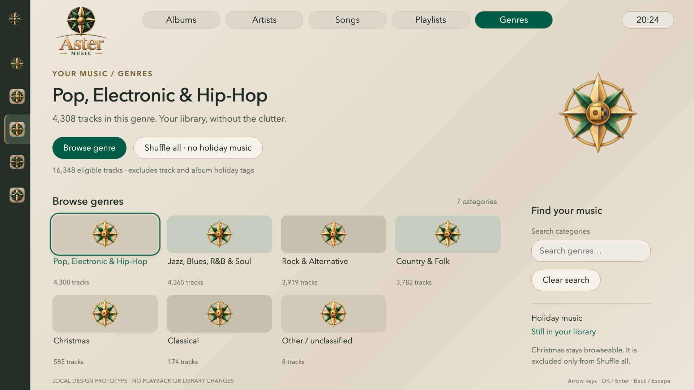

# Aster v2 M1 Music interaction prototype

Local design review only, not a Kodi add-on or a deployed player. Uses the
existing supplied Aster PNG assets without recreating them. Category counts
are aggregate snapshot memberships, not live search results or distinct totals.
The clock is a static layout fixture. No credentials, media paths, API calls,
queue mutations or playback are present. Other destinations and genre detail
open explicitly labelled preview explanations rather than fake live pages.

From the repository root:

```sh
python3 -m http.server 8793 --bind 127.0.0.1 --directory services/kodi
```

Open `http://127.0.0.1:8793/v2/prototype/`. Use arrow keys, Enter and Escape.
The composition targets a 1920×1080 TV canvas, scaled proportionally. Search
also supports ordinary keyboard text editing. Christmas remains browseable;
the separate non-holiday shuffle action shows its proposed eligibility rule.

```sh
node services/kodi/v2/prototype/test_focus.cjs
node services/kodi/v2/prototype/test_browser.cjs
```

The second command requires Playwright and its Chromium runtime available to
Node (for example through `NODE_PATH`). Optional URL argument must use
127.0.0.1; `ASTER_PREVIEW_PNG` optionally saves the checked browser view.

## Verification — 2026-10-23

- Ten pure focus checks, including exhaustive bounds across 1–29 items.
- Chromium checked all supplied images load, short-row column restoration,
  immediate Music focus on rail entry, Back restoration, correct hero entry,
  search/empty/clear, preview dialog focus restoration and shuffle counts.
- All tile bounds clear the footer; no horizontal overflow at 1280×720.
- No page errors or external page requests. Screenshot visually inspected
  at 1920×1080. This is not proof of Kodi/G20 behavior or sofa readability.
- Eleven music policy tests and three unchanged v1 package tests pass.

Owner visual/category-policy review and a bounded HP implementation/rollback
proposal remain outstanding. No client installation is authorized by this file.


